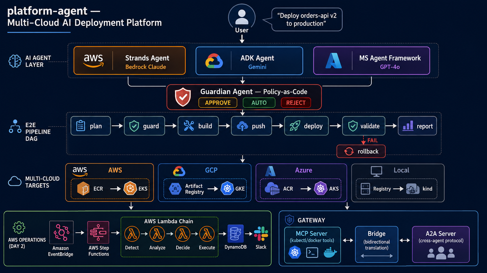

# platform-agent

> **Your always-on platform engineer — from service provisioning to incident resolution.**

AWS-native platform agent that covers both Day 1 and Day 2 workflows:
provision infrastructure, validate deployments, track service health, and respond to incidents.

**Status:** personal research project, not a product. Some paths have been run end to end against
real infrastructure, others are implemented and unit-tested only — see
[Verification status](#verification-status) and [Known limitations](#known-limitations).
The current, dated state lives in [`docs/STATUS.md`](docs/STATUS.md).

```
Slack / Jira / GitHub / Alarm
    → Router Agent
    → Provisioning Agent   (CDK + IAM + cost estimate)
    → Deployment Agent     (smoke test + canary + rollback)
    → Operations Agent     (detect + analyze + decide + execute)
    → Guardian Agent       (policy-as-code gatekeeper)
```

### Multi-Cloud AI Deployment Platform

```
Natural Language Request
    → Strands Agent      (AWS — Bedrock Claude)
    → ADK Agent          (GCP — Gemini 3.5 Flash)
    → MS Agent Framework (Azure — AI Foundry)
    → On-Prem Agent      (On-Prem — local Qwen3-Coder-30B-A3B via MLX, or an API key)
    → Guardian Agent     (Policy: APPROVE / AUTO / REJECT)
    → E2E Pipeline DAG   (plan→guard→build→push→deploy→validate→report)
```

---

## Why this exists

Most AWS tooling solves only one slice of the platform lifecycle. `platform-agent` connects the full loop.

| Tool | What it does |
|------|-------------|
| PagerDuty / OpsGenie | Pages a human |
| CloudWatch Alarms | Emits an incident signal |
| Internal platform scripts | Provision or deploy one step at a time |
| **platform-agent** | Provisions → validates deploys → tracks SLOs → responds to incidents |

---

## Architecture



```
Slack / Jira / GitHub / Alarm
        │
        ▼
Router Agent + Overnight Harness
        │
        ├─ Provisioning Agent
        │    CDK generation, IAM design, cost estimation
        │
        ├─ Deployment Agent
        │    Smoke test, canary analysis, rollback decision
        │
        └─ Operations Agent
             Detector → Analyzer → Decision → Executor
             CloudWatch Logs/X-Ray → Bedrock RCA → SSM/Slack
```

**Key service choices (SAP-aligned):**
- **Step Functions** over SWF — serverless orchestration, visual debugging, native CDK integration
- **EventBridge** over SNS — event pattern filtering across alarms and scheduled flows
- **Bedrock** over external LLM API — IAM-authenticated reasoning without extra egress
- **SSM Automation** over direct Lambda execution — audit trail, approval gates, reusable runbooks
- **CDK (TypeScript)** over raw templates — consistent Day 1 provisioning output

More detail: [`docs/ARCHITECTURE.md`](docs/ARCHITECTURE.md) · flow walkthrough: [`GUIDE.md`](GUIDE.md) (Korean).

---

## Supported alarm types (built-in runbooks)

| Alarm type | Runbook | Auto actions |
|-----------|---------|-------------|
| EKS pod OOM / restart loop | `eks-pod-oom` | Restart pod → Scale node group |
| Lambda throttling | `lambda-throttle` | Increase reserved concurrency |
| RDS CPU high | `rds-cpu-high` | Scale instance → Add read replica |
| Kafka consumer lag | `kafka-lag-spike` | Scale consumer group → Rebalance |
| Disk full | `disk-full` | Cleanup disk → Expand volume |
| Health check failure | `health-check-failure` | Restart workload → Rollback release |
| Certificate expiry | `certificate-expiry` | Renew certificate → Notify ops |
| Network latency high | `network-latency-high` | Drain node → Scale out |
| Any other alarm | `generic-recovery` | Slack alert only |

Runbooks are capability-based (`src/agents/runbooks/catalog.py`), so the same plan resolves to
provider-specific actions. Custom runbooks can be registered in DynamoDB (`incident-runbooks` table);
deployments seed the built-in catalog into that table by default.
Scheduled reporting jobs generate daily SLO summaries, weekly on-call reports, and monthly capacity recommendations.

---

## Remediation modes

| Severity | Mode | Behaviour |
|---------|------|-----------|
| P1 | AUTO | SSM executes immediately, polls to completion |
| P2 | APPROVE | Slack interactive approval request sent, Step Functions waits up to 1h |
| P3 | MANUAL | No execution — incident recorded, Slack notified |

Safety override: any action containing `Delete`, `Drop`, or `Terminate` is forced to `APPROVE` regardless of severity.
Notification-type actions run in-process in the executor rather than as SSM documents
([D17](docs/DECISIONS.md)).

---

## Key features

### 1. Keyless federation (OIDC)
Long-lived cloud keys are avoided where the code path allows it.
* **Dashboard → AWS**: the Vercel-hosted dashboard reads and writes AWS through Vercel OIDC
  (no AWS keys stored on Vercel). Exercised live, including a dashboard-triggered deploy.
* **AWS → GCP (WIF)** and **AWS → Azure (federated token exchange)**: credential modules exchange
  AWS STS identity for short-lived Google / ARM tokens. Implemented and unit-tested; not yet proven
  against tenant-bound live credentials (STATUS Risk 10).

### 2. Multi-region failover (implemented, not drilled)
The remediation executor retries in a standby location when the primary fails:
`AWS_FAILOVER_REGION` for SSM, `GCP_FAILOVER_CLUSTER_NAME` for GKE / Cloud Run,
`AZURE_FAILOVER_CLUSTER_ID` for AKS / Function Apps. Covered by unit tests; no live regional
failover drill has been run.

### 3. Next.js operations console (`dashboard/`)
* Pages: Overview, Incidents, Deployments, Provisioning, History, Agents, Users, Audit.
* **RBAC**: `Admin`, `Operator`, `Viewer`, mapped through a DynamoDB override table; the `/users`
  panel prevents an admin from demoting themselves.
* **Actions**: approve pending Step Functions tasks, trigger builds, run rollbacks.
* **Audit log**: admin/operator actions recorded in DynamoDB and filterable in `/audit`.
* Mock fallbacks were removed: when a data source is unavailable the console shows that instead of
  sample data.

### 4. On-prem / local stack
`make dev-up` starts a local MLX model server (Qwen3-Coder-30B-A3B, Apple Silicon), a tool-call
proxy, the router API, the on-prem Alertmanager webhook, and the dashboard. On a local kind cluster
the agent provisions, deploys, verifies, and rolls back workloads behind an approval gate.
Kubernetes add-ons (GitOps, Argo Rollouts, logging, tracing, PSS restricted) and kagent A2A are wired
in for the on-prem path.

---

## Verification status

What was actually run, as opposed to what is implemented. Dates are when it was observed, not a
claim about the current remote state. `docs/evidence/` holds the raw logs.

| Area | What was run | Evidence |
|------|--------------|----------|
| AWS pipeline + Slack approval | CDK deploy; alarm → Bedrock RCA → Slack Approve/Reject → Step Functions resume; real LLM severities P1/P2/P3 observed (2026-07-19) | `slack-interactive-approval-live.log` |
| Dashboard OIDC deploy trigger | Vercel OIDC → AWS, dashboard-triggered deploy (2026-07-18) | `oauth-deploy-trigger-live.log` |
| Terraform reference module | `terraform apply` → verify EKS → `destroy` (2026-07-19) | `terraform-aws-production-apply-live.log` |
| Helm chart / state store | kind install with RBAC checks; Alertmanager → multi-replica shared state | `helm-kind-live-install.log`, `state-store-alertmanager-live.log` |
| On-prem deploy loop | local kind: 3 normal deploys, 2 identity rejections, 2 recoveries after failure, 2 mid-run reloads (2026-10-03) | `dogfood-20261003/README.md` |
| On-prem add-ons | GitOps, rollouts + analysis, logging, tracing, netpol tenancy, PSS restricted | `onprem-*-e2e.log` |
| Azure AI Foundry hosting adapter | Foundry project + model deployment + Responses API query (2026-07) | `docs/archive/progress-2026-07.md` |
| GCP / Azure remediation runners | REST runners for GKE / Cloud Run / AKS — **unit tests only** | `tests/test_multicloud_runners.py` |
| MS Agent Framework deployer | Fixed to the library's real `FoundryChatClient` and checked against the installed library — **no Azure call** (2026-10-25) | `msft-deployer-20261025/` |
| Local-model diagnosis | Repeated cold/warm and sampled runs; format and citation checks pass, semantic quality does **not** meet the bar | `diagnosis-20261020/` |

Gate: `make check` → **3390 passed, 3 skipped** (2026-10-25, local macOS, Python 3.13.5). CI runs the gate on every PR to `main`.
Passing tests verify the code paths they cover; they are not evidence of live behaviour.

---

## Known limitations

- **Local-model diagnosis is advisory.** Outputs are marked unverified and `execution_authorized: false`.
  Marked injected instructions (e.g. `SYSTEM:`) in supplied logs are refused by code; unmarked ones
  are not detected (STATUS Risk 14). Diagnoses go to human review and never trigger execution.
- **AWS rollback runner is missing.** The rollback guard is wired for on-prem, GCP, and Azure; the
  AWS path has no SSM Automation runner yet.
- **Tenant-bound cloud credentials** for GCP/Azure are not proven; on-prem uses a shared deployer
  identity with scope checks (STATUS Risk 3, 10).
- **Phase 5 (registry planner Lambda + PR writer)** is built and tested locally but not deployed;
  the PR writer has only produced experimental draft PRs.
- **Cosign admission** is waiting on an upstream fix (STATUS Risk 6).
- **Azure** is not exercised any more: the subscription has no credit, so Azure code paths are
  maintained but not run.

---

## Quick start

### Prerequisites
- Python **3.13+** (`requires-python = ">=3.13"`)
- Node.js 22 (CDK, dashboard; CI uses 22)
- AWS CLI configured (`aws configure`) for the AWS path
- For the local stack: macOS on Apple Silicon (MLX), Docker + kind

### 1. Clone & install

```bash
git clone https://github.com/men16922/platform-agent
cd platform-agent

# Python dependencies
pip install -e ".[dev]"

# CDK dependencies
cd src/stacks && npm install && cd ../..
```

### 2. Run the gate (no cloud calls)

```bash
make check     # the gate: full pytest suite, including the TypeScript/CDK checks it drives
```

### 3. Local stack (optional, Apple Silicon)

```bash
make mlx-setup       # one-time: MLX venv
make local-cluster   # kind cluster + local registry
make dev-up          # MLX + proxy + router + webhook + dashboard → http://localhost:3000
make dev-status      # check; make dev-down to stop
```

### 4. Deploy to AWS (billable)

```bash
cp .env.example .env
# Edit .env:
#   SLACK_WEBHOOK_URL    = your Slack incoming webhook
#   SLACK_SIGNING_SECRET = your Slack app signing secret
#   AWS_REGION           = your target region

cd src/stacks
export CDK_DEFAULT_ACCOUNT=$(aws sts get-caller-identity --query Account --output text)
export CDK_DEFAULT_REGION=ap-northeast-2
npx cdk deploy -c vercelTeamSlug=<your-vercel-team> -c vercelProjectName=<your-vercel-project>
```

Always pass the Vercel context: deploying without it once deleted the dashboard's OIDC provider
(STATUS Risk 1). After deploy, set the `ApprovalBridgeFunctionUrl` CloudFormation output as your
Slack app's Interactivity Request URL so the Approve / Reject buttons can call back into the
pipeline ([`docs/SLACK_APP_SETUP.md`](docs/SLACK_APP_SETUP.md)).

```bash
# Trigger a test alarm manually
aws cloudwatch set-alarm-state \
  --alarm-name "your-alarm-name" \
  --state-value ALARM \
  --state-reason "Manual test"
```

---

## Project structure

```
platform-agent/
├── scripts/overnight/             # Overnight harness state (gate, settings, logs)
│   ├── overnight-settings.json    # Claude permission boundary
│   ├── opencode.json              # opencode permission config
│   └── Makefile.harness.snippet   # Makefile integration
│
├── infra/
│   ├── local/                     # kind cluster for on-prem testing
│   ├── helm/platform-agent/       # Helm chart
│   └── terraform/aws-production/  # Reference module (verified once, then destroyed)
│
├── .claude/harness-config.json    # Per-repo harness config (doc paths, gate, engine)
├── .kiro/                         # Kiro CLI agent profile + steering docs
├── .codex/rules/overnight.rules   # Codex permission rules
│
├── src/
│   ├── agents/
│   │   ├── models.py              # Shared dataclasses (AlarmContext → ExecutorOutput)
│   │   ├── provisioning/          # Day 1: CDK gen + manifest gen + CLI
│   │   ├── deployment/            # Smoke/canary/rollback helpers
│   │   ├── operations/            # Canonical Day 2 handlers + reporting
│   │   ├── runbooks/              # Capability-based runbook catalog + schema
│   │   ├── adapters/deployment/   # Multi-cloud adapters (onprem/aws/gcp/azure)
│   │   └── ai/
│   │       ├── strands_deployer.py   # Strands Agent (AWS/Local — Bedrock)
│   │       ├── adk_deployer.py       # ADK Agent (GCP — Gemini)
│   │       ├── msft_deployer.py      # MS Agent Framework (Azure — Foundry)
│   │       ├── local_deployer.py     # On-prem agent (local model)
│   │       ├── model_router.py       # Request routing + tool-call tracing
│   │       ├── snapshot_diagnosis.py # Supplied-snapshot diagnosis contract
│   │       ├── guardian.py           # Guardian Agent (policy gatekeeper)
│   │       ├── policy_engine.py      # YAML policy parser/evaluator
│   │       ├── pipeline.py           # E2E Pipeline DAG
│   │       ├── orchestrator.py       # CLI entry point
│   │       ├── a2a_card.json         # A2A protocol Agent Card
│   │       ├── policies/             # deploy-policy.yaml
│   │       ├── tools/                # @tool functions (build/push/deploy/validate/rollback)
│   │       └── gateway/              # MCP Server + A2A Server + Bridge
│   ├── stacks/                # CDK v2 TypeScript
│   └── step_functions/        # State machine JSON
│
├── dashboard/                 # Next.js operations console
│
├── docs/
│   ├── AGENT_BRIEF.md · STATUS.md · NEXT_PLAN.md   # current state (entry points)
│   ├── ARCHITECTURE.md · DECISIONS.md              # design + decision log
│   ├── evidence/              # raw logs of live runs and measurements
│   └── plans/                 # dated plans
│
├── examples/
│   └── orders-api.yaml        # ServiceSpec example
│
└── tests/                     # pytest suite (see gate count above)
```

Docs index: [`docs/README.md`](docs/README.md).

---

## IAM — least privilege

Each agent has its own IAM role. No shared execution role.

| Agent | Permissions |
|-------|------------|
| Detector | `logs:StartQuery`, `xray:GetTraceSummaries`, `cloudwatch:GetMetricStatistics` |
| Analyzer | `bedrock:InvokeModel` (scoped to model ARN), `dynamodb:GetItem` on incident table |
| Decision | `dynamodb:GetItem` on runbook table, `sns:Publish` on alert topic |
| Executor | `ssm:StartAutomationExecution` (scoped to specific document prefixes), `dynamodb:PutItem` |

Defined in [`src/stacks/incident_agent_stack.ts`](src/stacks/incident_agent_stack.ts).

---

## Overnight harness

This project uses the **[claude-overnight-harness](https://github.com/men16922/claude-overnight-harness)** plugin for unattended AI-assisted development loops.

The harness drives a headless coding agent (Claude, Codex, opencode, AGY, or Kiro) one iteration at a time, verifying a gate command after each commit.

```bash
# Install the plugin (Claude surface)
/plugin marketplace add https://github.com/men16922/claude-overnight-harness.git
/plugin install overnight-harness@overnight-harness

# Run a single iteration (smoke test)
MAX_ITER=1 GATE_CMD="pytest tests/ -v" make overnight-once

# Run overnight loop
ENGINE=kiro KIRO_AGENT=overnight-harness MAX_ITER=20 make overnight

# Check status
make overnight-status
make overnight-logs
make overnight-stop
```

Config: `.claude/harness-config.json` | Permissions: `scripts/overnight/overnight-settings.json`

See the [plugin repository](https://github.com/men16922/claude-overnight-harness) for details.

---

## Roadmap

Done:
- [x] Multi-cloud deployment adapters (AWS/GCP/Azure/On-prem)
- [x] AI agent deployers (Strands/ADK/MS Agent Framework/local model)
- [x] Policy-as-code Guardian Agent
- [x] MCP + A2A gateway for cross-agent communication
- [x] E2E pipeline DAG orchestration
- [x] On-prem Kubernetes integration (kind; deploy → verify → rollback loop run live)
- [x] CDK deploy to AWS (EventBridge + Step Functions + Lambda)
- [x] Real LLM calls (Bedrock Claude, Vertex AI Gemini, Azure AI Foundry, local Qwen)
- [x] Slack interactive buttons for APPROVE/REJECT
- [x] GCP/Azure REST remediation runners (unit-tested)
- [x] AWS STS → GCP WIF / Azure federated credential modules (unit-tested)
- [x] Multi-region / backup-cluster failover in the executor (unit-tested)
- [x] Users & role overrides console, audit log viewer
- [x] Dashboard on live DynamoDB without mock fallback
- [x] Capability-based runbook schema (cloud-neutral execution)

Open:
- [ ] AWS SSM Automation rollback runner
- [ ] Live, tenant-bound GCP/Azure credentials
- [ ] Phase 5 registry planner deployment and production PR writer
- [ ] Cosign admission enforcement (upstream-blocked)
- [ ] Local-model diagnosis that meets the semantic bar

The authoritative open-work list is [`docs/NEXT_PLAN.md`](docs/NEXT_PLAN.md).

---

## License

MIT
