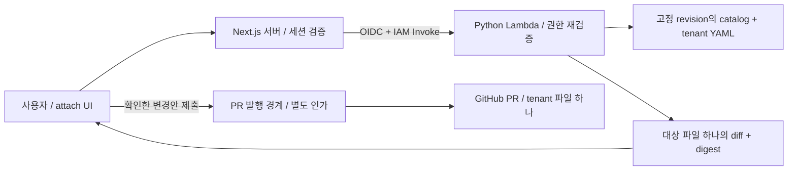

# Phase 5 — Python 플래너 실행 위치와 PR 쓰기 경계

작성: 2026-09-05 · 갱신: 2026-09-13 · 상태: **M90 AWS 읽기 점검·배포 후보/실행안 준비. Vercel 인증/현행 배포 확인 대기. 원격 변경·운영 발행은 미완료**

## 1. 선택

**프로덕션 플래너는 독립 AWS Lambda(Python 3.13)에서 실행한다.** Vercel의 Next.js 서버가 기존 OIDC 자격증명 경로를 이용해 Lambda Invoke API로 호출한다. Function URL·새 API Gateway·상시 서버는 이 경로에 추가하지 않는다. 로컬 개발에서는 같은 Python 진입 함수를 직접 호출한다.

플래너의 결과는 **한 테넌트 파일의 변경안**이다. GitHub 쓰기 토큰을 받지 않고, git commit·push·PR 생성도 하지 않는다. PR 발행기는 별도 경계로 설계하며 §5의 자격증명 조건을 충족한 뒤 연결한다. 이 분리는 최종 UI→PR 목표의 단계이며, preview만으로 Phase 5 완료를 선언하지 않는다.

## 2. 이전 재개 조건을 대조한 결과

| 기존 주장 | 확인한 사실 | 설계에 주는 의미 |
|---|---|---|
| FastAPI 층이 아예 없다 | `src/agents/ai/local_deploy_api.py`에 FastAPI와 `/api/platform/tenants`, `/api/platform/status`가 이미 있다 | 서비스 부재가 구속 조건은 아니다. 기존 서비스에는 배포·LLM 경로도 있어 PR 권한을 섞지 않는다 |
| Vercel에는 Python·파일시스템이 없다 | Vercel은 Python/FastAPI와 쓰기 가능한 임시 디렉터리를 지원한다 | Vercel에서 불가능하다는 배제 근거를 철회한다. 현재 Next.js 앱에 Python 플래너가 배치돼 있다는 뜻은 아니다 |
| 플래너 실행에는 git 작업 트리가 필요하다 | 기존 두 파일 실증은 호스트의 Helm values를 추가로 읽었다(M55에서 발견) | `.git`은 불필요하지만 **catalog + tenant + 대상 values** 세 파일을 같은 SHA로 읽어야 호스트 의존성이 사라진다 |
| GitHub App이면 파일 단위로 쓰기가 제한된다 | App API에 `single_file: read/write`가 존재한다. 그러나 새 branch ref 생성 API는 `Contents: write`를 요구한다 | single_file의 존재도, 일반 Contents 토큰도 자동 PR 흐름 전체의 tenant 경계를 증명하지 않는다 |

초기 실증(M53, 호스트 values 의존성은 당시 미검사): Python 3.13.5, `acme/prod`에 `logging`을 계획 → `loki 7.1.0`, 대상 `tenants/acme.yaml` 하나, 출력 1,538바이트. 입력 스냅샷·실제 레지스트리는 그대로였다. 증거: `docs/evidence/phase5-planner-runtime-2026-09-05.log`.

## 3. 실행 위치 비교

| 후보 | 장점 | 추가로 부담하는 것 | 판단 |
|---|---|---|---|
| 기존 로컬 FastAPI | 기존 Python과 UI 프록시를 재사용 가능 | 공개 Vercel에서 로컬 주소에 도달하지 못함. 외부 호스팅·요청 인증 필요. LLM/배포 의존성까지 함께 운영 | 개발용 재현에 사용 |
| Vercel Python Function | Python 실행 가능, 프런트엔드와 가까움 | 현재 배포 루트는 dashboard. Python 코드 패키징과 서버 간 사용자 인가 전파를 새로 검증해야 함 | 유효한 대안으로 유지 |
| **독립 Lambda + Invoke API** | 기존 AWS OIDC 경로와 CDK에 연결. 역할·배포 패키지를 플래너 용도로 분리 | 함수·IAM·로그 설정 추가, 호출 비용과 지연 실측 필요 | **선택** |
| Step Functions로 매 preview 실행 | 워크플로 이력·재시도 제공 | 현재는 짧은 결정적 계산 한 단계. preview에 상태 머신을 추가할 근거가 없음 | PR 발행이 장기 비동기 흐름이 될 때 재평가 |

SAP 관점: 역할을 분리하면 최소권한 검토와 장애 원인 추적이 단순해진다. 요청 때만 실행하는 선택은 상시 서버의 운영 부담을 줄인다. **무료라고 가정하지 않는다.** 비용은 요청 수·실행 시간·메모리·로그·비밀 저장 방식의 함수이며 원격 측정 전 월액을 고정하지 않는다.

## 4. 호출·인가·변경안 계약



### 입력

- UI의 요청은 `{tenant, env, capability, version}`뿐이다. `path`, `repository`, raw YAML, backend, role, grants, git branch, URL은 요청자가 지정할 수 없다.
- Next.js 서버는 Auth.js 세션에서 username을 얻는다. 브라우저가 보낸 username을 전달하지 않는다. UI 변경 요청은 same-origin/CSRF 검증도 통과해야 한다.
- Lambda는 IAM으로 **호출 서비스**를 확인한다. IAM은 최종 사용자의 테넌트 권한을 증명하지 않는다. Lambda는 전달된 세션 주체의 **현재 저장 레코드**를 다시 읽는다. 이 설계는 Next.js 세션 검증기를 신뢰 경계에 포함한다.
- **기존 `getUserRecord()`를 live 쓰기 인가에 그대로 쓰지 않는다.** 현재 AWS 읽기 실패 시 demo 레코드로 fallback한다. 쓰기 경로에는 저장소 장애→503, 레코드 없음→403인 전용 조회가 필요하다. 세션의 오래된 role도 쓰기 권한의 최종 근거가 아니다.
- 읽기용 `UserRecord.tenants`를 쓰기 grant로 승격하지 않는다. 현재 role이 operator/admin이고, 새 `registry_write_tenants`가 대상 tenant를 포함해야 한다. viewer는 write grant가 있어도 거부한다. 초기 버전에서는 admin도 명시적 write grant가 필요하며 미설정은 거부한다. 기존 설정·읽기 동작은 유지한다.

P5-B 구현: `CurrentUserReader.get_current_user()`는 매 호출 현재 레코드를 반환하며 없음은 None, 장애는 예외다. username을 기존 저장 키처럼 소문자로 정규화하고 반환 레코드의 username과 일치시킨다. role은 operator/admin, `registry_write_tenants`는 문자열 목록의 정확 tenant 이름이어야 한다. 읽기 grants·세션 role·데모 fallback을 사용하지 않는다. 요청을 조회 전에 복사해 승인 tenant와 실제 플래너 입력을 고정한다. 현재성·원본 진위는 신뢰하는 저장소 어댑터가 보장해야 하며, 제출 때도 다시 인가한다.

### 스냅샷과 출력

1. 저장소·기본 브랜치는 서버 설정으로 고정한다. 서버가 기본 브랜치의 commit SHA를 읽는다.
2. **같은 SHA**에서 `platform/catalog.yaml`, `platform/tenants/<tenant>.yaml`, 대상 capability의 `self_hosted_values`를 가져온다. values 경로는 `infra/onprem/addons/values/<이름>.yaml`로 제한한다. 각 파일 256 KiB 이하·UTF-8·중복 키/alias 없는 YAML을 검사하고 commit/path/Git blob SHA-1 일치를 확인한다. commit 소속 검증은 신뢰하는 읽기 어댑터의 책임이다.
3. 요청별 임시 디렉터리에 세 파일만 저장하고 기존 `plan_addon_attachment(values_repo_root=...)`를 호출한다. 설치 가능성 검사는 유지하며 호스트 values로 fallback하지 않는다. 전역 temp 경로·프로세스 메모리를 tenant 상태 저장소로 쓰지 않는다.
4. 응답은 `request_id`, `base_commit`, `catalog_blob`, `tenant_blob`, `values_path`, `values_blob`, `path`, `diff`, `output_sha256`, `contract_version`, `digest`, `expires_at`를 담는다. host의 `/tmp/...` 절대 경로·GitHub 토큰은 노출하지 않는다.
5. digest는 주체·tenant/env·capability/version·base_commit·세 blob·출력 SHA-256·계약 버전과 응답 전체를 덮는다. 유효 기간은 서버 시각부터 5분이다. digest는 서명이 아니며 인증을 대신하지 않는다. 후속 제출 구현에서는 변경안을 서버 측 기록으로 보관하고, 클라이언트가 돌려준 diff를 신뢰하지 않는다.
6. 제출 시 권한·기본 브랜치 SHA·만료를 다시 확인한다. SHA가 바뀌면 **409 + 재계획**이다. 새 diff에 사용자 확인을 자동 승계하지 않는다.

Invoke 응답의 HTTP 200만으로 성공을 판정하지 않는다. SDK의 `FunctionError`와 반환된 업무 결과를 함께 확인한다.

오류 계약: 401 세션 없음, 403 쓰기 grant 없음, 409 revision 변경/이미 부착/충돌, 422 잘못된 요청·카탈로그 조건, 503 저장소·GitHub 읽기 장애. preview 실패를 빈 diff 또는 성공으로 반환하지 않는다.

### AWS 권한

- Vercel 호출 역할: 해당 planner 함수 ARN에 `lambda:InvokeFunction`만 추가하는 **전용 역할**. 기존 범용 대시보드 역할을 그대로 쓰지 않는다. OIDC subject는 production으로 한정하고 preview 배포는 호출 불가로 시작한다.
- 플래너 실행 역할: 사용자 테이블의 `GetItem`, 별도 계획 테이블의 `GetItem/PutItem/UpdateItem`, 필요한 읽기 전용 레지스트리 접근, 지정 로그 그룹 쓰기. 계정 전체 Scan·클러스터·배포·GitHub Contents 쓰기 권한은 없다.
- GitHub App이 필요한 private 레지스트리에서는 설치 대상 저장소와 `contents: read`를 명시적으로 좁힌 토큰만 플래너에 공급한다. App 서명키를 주면 쓰기 토큰을 발급할 수 있으므로 **공유 write App의 서명키를 플래너에 주지 않는다**.
- 이 문서는 IAM 설계다. 이번에 역할·함수·비밀·Vercel 설정을 생성하거나 변경하지 않았다.

## 5. PR 발행에서 아직 증명하지 못한 것

`plan_addon_attachment()`의 한 파일 변경 검증과 `commit_attachment()`의 경로 한정 commit은 **요청/출력 경계**다. 저장소 전체 `Contents: write` 토큰의 탈취까지 tenant 하나로 제한하는 경계는 아니다.

일반 App 설치 토큰은 저장소와 permission을 좁힐 수 있다. **`single_file` 권한도 공식 API에 있으므로 없다고 단정하지 않는다.** 하지만 새 ref 생성에는 문서상 `Contents: write`가 필요하다. 따라서 "single_file 토큰으로 branch 생성→파일 수정→PR 생성까지 된다"는 가설은 아직 입증되지 않았다.

| 발행 방식 | 보장과 한계 | 재개 조건 |
|---|---|---|
| 현재 local commit + 운영자 PR | 기존 한 파일 변경 검증을 사용. 실제 git 자격증명은 운영자 것 | 지금 존재하는 경계이며 자동 UI 제출의 완료는 아님 |
| 공유 PR 발행기 + 일반 App token | 매 요청의 파일/내용/commit tree는 검사 가능. 토큰 권한은 repo 전체 | **자격증명 침해까지 tenant 하나**라는 조건을 유지한 채 완료로 간주할 수 없음 |
| single_file App 경로 | 파일 수정 권한을 좁힐 가능성이 공식 스키마에 존재 | 별도 검증 저장소·App에서 branch 생성, 대상 파일 수정, 형제 파일 거부, PR 생성 네 호출을 실제로 검증해야 함 |
| tenant별 저장소·설치 토큰 | 저장소 경계가 tenant 경계와 일치 | 기존 레지스트리·delivery가 같은 repo의 tenant 파일을 읽는 설계를 바꾸므로 별도 마이그레이션 결정 필요 |

**현재 선택은 권한을 넓혀 자동 발행을 강행하지 않는 것**이다. 먼저 preview 경로를 구현하고, writer는 위 네 호출의 증거 또는 tenant별 저장소 설계를 확보한 뒤 연결한다. CODEOWNERS는 현재 리뷰 라우팅이며 자동으로 이 경계를 보강하지 않는다(D43).

발행 구현 시 추가 불변식: 한 request_id에는 하나의 PR, timeout 후 무조건 새 branch를 만들지 않음, 예상 base와 parent 일치, 최종 tree diff가 허용 파일 하나뿐임, 해당 파일에서도 addon key 하나만 바뀜, main 직접 갱신·자동 merge 없음. 성공은 PR URL을 확인한 뒤 기록한다. audit 쓰기 실패 시 새 발행을 시작하지 않는다.

## 6. 구현 순서와 완료 증거

| 순서 | 작업 | 완료 증거 |
|---|---|---|
| P5-A 완료(M55) | `registry_planner.plan_snapshot()` + 주입되는 읽기 어댑터. 인증·네트워크 구현 없음 | 실제 파일 세 개로 호스트 의존성 차단·결정적 diff·입력 불변; 잘못된 요청/YAML/크기/변조/다른 tenant·env 변경 거부 |
| P5-B 완료(M56) | `registry_authorization.plan_authorized_snapshot()` + `CurrentUserReader` | 현재 username·역할·명시적 write grant 확인 후 P5-A 호출; 거부 시 registry 읽기 0; 회수·삭제·장애·요청 변조 검증 |
| P5-C 완료(M57) | Lambda handler·GitHub/DynamoDB 읽기·별도 CDK stack·Linux ARM64 패키징 | 실제 DynamoDB Local SDK 200/403/503, Git tree/blob 및 합성 IAM 검사, production subject, GitHub 토큰/비밀 권한 없음 |
| P5-D 완료(M58) | Next.js attach preview UI와 서버 route | 실제 로컬 세션의 역할별 HTTP 매트릭스; 요청자 username/role/path 위조 거부; diff와 revision 표시; 실패/연결 없음 구분 |
| P5-E | §5의 발행 자격증명 경계 실증 후 PR adapter·제출 UI | 실제 GitHub PR의 changed files가 대상 파일 하나; 동시 변경·재시도·권한 회수·다른 tenant 조작 거부 |
| P5-F | 운영 연결과 최종 검증 | 원격 IAM 무권한 호출 거부, 승인된 역할 성공, preview→확인→실제 PR URL; live 결과와 offline 결과 구분 |

**P5-E 실증안은 §10·M59로 준비했다. 다음은 제시한 새 lab/App 생성·권한 부여·시험·정리 범위를 검토받고 실제 경계를 측정하는 것이다.** 로컬 세션·preview UI·표시 만료는 M58로 검증했다. 원격 배포·계획 저장·제출 시 만료/재제출 검증은 남았다. P5-C는 공개 저장소만 읽고 private GitHub/token 경로는 구현하지 않는다. DynamoDB Local 검증은 AWS 운영 연결의 증명이 아니다. M55 증거는 `docs/evidence/phase5-snapshot-planner-2026-09-05.log`, M56은 `docs/evidence/phase5-write-grants-2026-09-05.log`다. M57 증거는 `docs/evidence/phase5-lambda-runtime-2026-09-05.log`다. P5-C의 원격 배포와 P5-E의 App/검증 저장소 생성은 실제 변경 목록을 확정한 뒤 실행한다.

Phase 4b는 별도다. GCP 비용 창 재측정은 현행 사용량의 관측이며 새 상시 GKE의 예산 승인이 아니다. 기존 4b 계획의 Config Sync 요금 조건·리전·운영 기간·30분 TTL 대체 종료 장치가 확정돼야 상시 실증안을 실행할 수 있다. 4a를 다시 열거나 TTL을 단순 해제하지 않는다.

## 7. 근거

- 로컬: `src/agents/platform/registry_write.py`, `src/agents/platform/registry.py`, `src/agents/ai/local_deploy_api.py`, `dashboard/src/lib/aws-client.ts`, `dashboard/src/lib/user-data.ts`, `src/stacks/incident_agent_stack.ts`.
- [Vercel Python runtime](https://vercel.com/docs/functions/runtimes/python): Python/FastAPI 실행 지원. [runtime 파일시스템](https://vercel.com/docs/functions/runtimes): 읽기 전용 배포 파일과 임시 저장 공간.
- [GitHub App installation token](https://docs.github.com/en/rest/apps/apps#create-an-installation-access-token-for-an-app): 저장소·permission 제한과 single_file 스키마. [Create a reference](https://docs.github.com/en/rest/git/refs#create-a-reference): 브랜치 생성에 필요한 Contents 권한.
- [AWS Lambda Invoke API](https://docs.aws.amazon.com/lambda/latest/api/API_Invoke.html): 동기 Invoke와 호출 권한. Function URL을 선택하면 필요한 권한이 더 있으므로 이 설계는 URL을 만들지 않는다.

외부 문서는 2026-09-05 조회했다. 서비스 가능성은 공식 문서, 이 레포에서 실제로 된 것은 별도 로컬 증거로 구분한다.

## 8. P5-C 구현과 로컬 재현 (M88 저장 연결 반영)

- `registry_lambda.handler`: IAM으로 허용한 Next.js 서버만 `{subject, request}`를 전달한다. 사용자 요청은 기존 네 필드이고 request ID·시각은 Lambda context/서버에서 얻는다. M88부터 optional operation=preview/prepare/status를 trusted 호출자가 지정한다. 생략은 저장형 preview이며 prepare/status의 request는 request_id 하나다. 반환은 plan/preparation/observation 또는 `{ok:false, status, error}`다. 호출자는 SDK `FunctionError`와 업무 `ok/status`를 둘 다 확인해야 한다.
- `DynamoCurrentUsers`: 요청마다 `GetItem(ConsistentRead=True)`. 캐시/demo fallback 없음. 이 선택은 [DynamoDB GetItem 계약](https://docs.aws.amazon.com/amazondynamodb/latest/APIReference/API_GetItem.html)의 강한 일관성 옵션을 사용한다.
- `GitHubSnapshotReader`: 고정 repository/branch의 commit→비재귀 tree→blob 순으로 읽고 경로·mode·SHA·크기를 대조한다. symlink·submodule·truncated tree·redirect는 거부한다. [Git trees API](https://docs.github.com/en/rest/git/trees)와 [Git blobs API](https://docs.github.com/en/rest/git/blobs)의 읽기 계약을 사용한다. 익명 제한/네트워크 오류는 503이며 자격증명 fallback은 없다.
- `RegistryPlannerStack`: 기존 운영 stack·OIDC provider를 수정하지 않는 별도 app이다. 기존 provider ARN을 import하고 [Vercel subject 형식](https://vercel.com/docs/oidc/reference)의 production만 허용한다. 함수 URL·Secrets Manager·GitHub token·새 사용자 테이블 없음. 기존 사용자 테이블의 정확 ARN GetItem과 전용 log group stream 쓰기를 유지한다. M88은 전용 Plans 테이블과 그 ARN의 GetItem/PutItem/UpdateItem만 추가한다. request_id 문자열 키·ttl·PITR·삭제 방지·Retain을 정의하며 CLAIMED의 TTL 제거는 앱 계약이다.
- 배포 패키지는 `scripts/build_registry_planner.py`가 고정 wheel 의존성과 플래너/저장/서비스 모듈 여덟 개만 복사한다. namespace package로 구성해 기존 platform 패키지의 delivery/cluster import를 포함하지 않는다. `requirements-registry-planner.txt`가 의존성 고정본이다.

```sh
python3.13 scripts/build_registry_planner.py --output /tmp/registry-planner-asset
npm --prefix src/stacks run build
# --app을 명시한다. 기존 incident app을 synth/deploy하지 않는다.
cd src/stacks
npx cdk synth --app 'node dist/bin/registry_planner.js' --output /tmp/registry-planner-cdk \
  -c plannerAccount=111111111111 -c plannerRegion=ap-northeast-2 \
  -c plannerAssetPath=/tmp/registry-planner-asset \
  -c plannerUsersTableArn=arn:aws:dynamodb:ap-northeast-2:111111111111:table/users \
  -c plannerRepository=men16922/platform-agent -c plannerBranch=main \
  -c vercelTeamSlug=example-team -c vercelProjectName=platform-agent \
  -c vercelOidcProviderArn=arn:aws:iam::111111111111:oidc-provider/oidc.vercel.com/example-team
```

위 ARN/team은 로컬 합성용 예시다. 실제 배포 값이나 사용자 권한을 이번에 설정하지 않았다. DynamoDB Local을 loopback에 실행한 뒤 `python3.13 -I -S scripts/verify_registry_planner_local.py --asset /tmp/registry-planner-asset --endpoint http://127.0.0.1:PORT`로 실제 SDK 검증을 재현한다. 스크립트는 자신의 임시 테이블만 생성·삭제하며 cloud endpoint를 거부한다. 패키지 Linux wheel 선택과 격리 import를 검사했으나 AWS Lambda의 원격 실행은 미검증이다.

CDK 테스트는 `src/stacks`의 npm 의존성이 없으면 명시적으로 skip한다. 이번 로컬에서는 실행됐으며 CI 설치/집행까지 완료했다고 주장하지 않는다. M58에서 `upsertUserRecord()`를 partial Update로 바꿔 role/read grant 변경이 별도 write grant를 덮지 않도록 했다. 실제 DynamoDB Local의 사용자 API 경로에서 최신 grant 보존과 테이블 장애 실패를 확인했다.

## 9. P5-D 구현과 다음 발행 실증

`POST /api/dashboard/platform/attach/preview`는 Auth.js session.user.username만 `{subject, request}`의 주체로 삼는다. 캐시된 session role이나 사용자가 보낸 username/role/path는 받지 않는다. 정확 Origin과 `X-Registry-Preview: 1`, same-origin fetch metadata(헤더 생략은 허용), JSON과 4 KiB 스트림 상한을 검사한다. [OWASP CSRF 지침](https://cheatsheetseries.owasp.org/cheatsheets/Cross-Site_Request_Forgery_Prevention_Cheat_Sheet.html)의 Origin/custom header 방식을 따르며 cross-origin CORS를 열지 않는다.

M63은 누적 4096바이트까지 허용하고 초과 시 읽기를 멈춰 취소를 요청한다. 취소 실패/미완료가 413 반환을 바꾸지 않으며 읽기 오류는 invalid_request(422), reader 잠금은 성공·실패 모두 해제한다. 실제 Node Web API 계약 검사이며 업로드 대기 시간 제한이나 원격 HTTP 검증을 뜻하지 않는다.

`REGISTRY_PLANNER_MODE=aws`는 `REGISTRY_PLANNER_FUNCTION_ARN`·`REGISTRY_PLANNER_ROLE_ARN`·`REGISTRY_PREVIEW_ORIGIN`을 사용한다. 기존 일반 dashboard 역할을 재사용하지 않는다. Vercel에서는 production만 허용하며 기존 Auth.js 설정도 필요하다. [동기 Invoke](https://docs.aws.amazon.com/lambda/latest/api/API_Invoke.html)의 StatusCode 200과 FunctionError를 따로 검사하고, 업무 오류와 불완전한 계획도 성공으로 표시하지 않는다. 응답은 no-store이며 요청 변경/만료 시 이전 preview를 제출할 수 있는 동작은 없다(제출 기능 자체가 후속 범위다).

로컬 재현은 dashboard npm 의존성과 Python 3.13 환경에서 `REGISTRY_PLANNER_MODE=local`, `REGISTRY_PLANNER_LOCAL_REPO`(이 레포 절대 경로), `REGISTRY_PLANNER_LOCAL_USERS`(username→현재 레코드 JSON), `REGISTRY_PLANNER_PYTHON`(인터프리터 절대 경로)을 지정한다. M72부터 `REGISTRY_PLANNER_LOCAL_PLAN_ENDPOINT`(HTTP numeric loopback)와 `REGISTRY_PLANNER_LOCAL_PLAN_TABLE`(미리 만든 request_id 문자열 파티션 키 테이블)도 필수다. 저장소 미설정/장애에는 preview 성공을 반환하지 않는다. 이 어댑터는 작업 트리의 미커밋 YAML이 아니라 Git HEAD blob을 읽는다. 사용자 JSON은 매 요청 다시 읽으며 실사용자 저장소의 fallback이 아니다. Vercel에서는 실행을 거부한다.

`DASHBOARD_DATA_SOURCE=demo DASHBOARD_DEV_AUTH=1 DASHBOARD_DEV_AUTH_USER=operator-demo`와 로컬 `AUTH_SECRET`, `AUTH_URL=http://localhost:3105`, `REGISTRY_PREVIEW_ORIGIN=http://localhost:3105`를 지정해 build/start한다. fixture 레코드에 operator/admin 역할과 `registry_write_tenants:["acme"]`를 넣으면 acme/prod/logging/7.1.0의 preview를 확인할 수 있다. viewer-demo는 거부한다. 로그인한 채 JSON의 grant를 지우면 다음 요청은 403이다. 서버 사용자 환경 변수를 바꿀 때는 프로세스를 재시작한다. 실제 DynamoDB Local 검증은 별도 loopback endpoint·임시 사용자/감사 테이블·dummy 자격증명으로 기존 사용자 POST route를 호출했고, role 변경 두 번과 최신 write grant 보존·감사 레코드·테이블 장애를 확인했다.

M58 증거는 `docs/evidence/phase5-preview-ui-2026-09-05.log`다. 로컬 38개 새 테스트, 실제 세션 HTTP·브라우저·DynamoDB Local 검증이며 원격 AWS 실행/배포나 GitHub PR 생성은 아니다. TypeScript 계약 실행은 dashboard npm 의존성이 없으면 skip한다.

**P5-E 준비 완료(M59)**: 이름·소유자·최소 permission·시험 파일/branch·네 호출의 판정·정리 대상을 §10과 로컬 요청 템플릿에 확정했다. 다음은 이 구체적인 생성/권한 부여 변경 목록을 검토받는 것이다. `single_file`로 ref 생성부터 PR까지 되는지 확인하기 전에는 Contents write로 넓혀 성공시킨 결과를 tenant 경계의 증거로 쓰지 않는다. 실증 뒤에만 PR adapter·서버 계획 저장·제출 시 재인가/revision/만료·멱등성을 연결한다.

## 10. P5-E 실증안 — 생성·권한 부여 전 검토본 (M59)

**2026-09-05 준비 완료, 실제 발행 실증은 미실행이다.** `experiments/phase5-writer/review.json`에 신원별 API 요청 본문·판정 조건, `seed/`에 가상 acme/globex 레지스트리, `expected/`에 변경 후 YAML·한 줄 diff, `app-registration.url`에 최소 권한 등록안을 준비했다. 이 파일들은 실행기가 아니며 원격 요청을 자동 전송하지 않는다. 기존 운영 서비스·레지스트리를 이 실험에 연결하지 않는다.

### 검토할 변경 목록

| 대상 | 제안한 정확 값 | 쓰기 범위와 수명 |
|---|---|---|
| 실험 저장소 | `men16922/platform-agent-p5e-authz-lab`, **private**, 새 저장소 | 가상 YAML 두 파일만 초기 commit. Actions off, workflow/secret/webhook/delivery 연결 없음. 종료 시 삭제 |
| GitHub App | `men16922-platform-agent-p5e`, Only on this account | 새 App 하나. `single_file:write` → `platform/tenants/acme.yaml`, `pull_requests:write`, 필수 `metadata:read`. Contents·Actions·Administration·OAuth·webhook 없음 |
| 설치 | 위 새 저장소 **하나만 selected** | production `men16922/platform-agent` 및 기존 App에 설치/권한 변경 없음 |
| 자격증명 | 새 App 전용 key 1개, installation token | key는 레포 밖 mode 0600, 로그/대화에 출력하지 않는다. JWT/토큰은 프로세스 메모리만. 사용 후 revoke·uninstall·App/key 삭제 |
| 시험 브랜치/PR | `p5e/20260905-01`, 필요 시 `p5e/20260905-01-diagnostic` | 같은 lab 안에서만 생성. draft PR 최대 1개, maintainer 수정 off, merge하지 않고 종료 시 close |

404만으로 이름이 사용 가능하다고 확정하지 않는다. 생성 시 충돌하면 기존 자원을 재사용하거나 이름을 임의 변경하지 않고 중단한다. 저장소·App·설치의 실제 numeric ID를 생성 응답에서 기록해 정리까지 대조한다. `gh`의 현재 계정은 men16922이며 운영 저장소 admin 읽기는 확인했다. `GET /user/installations`는 현재 토큰 종류로 403이었다. 이를 App 부재로 읽지 않았고 **소유자 설정 UI에 실험 App이 없는 것**을 따로 확인했다. 등록 폼에서도 single-file 경로·PR write·Contents No access·Only on this account·webhook off를 확인했으며 **Create 버튼은 누르지 않았다**.

### 준비와 신원 분리

1. 승인된 경우에만 새 private lab을 생성하고 Actions를 끈다. 새 임시 Git 저장소에 `seed/platform/tenants/{acme,globex}.yaml` 두 파일만 넣어 초기 commit을 push한다. 플랫폼 레포의 checkout이나 git remote를 재사용하지 않는다. 운영자 신원으로 기본 브랜치가 `main`인지, seed tree의 경로·파일 mode·blob이 예상과 같은지 검사하고 commit SHA를 **B**로 고정한다. 가상 cluster 이름은 실행 대상이 아니다.
2. 등록안의 새 App을 생성하고 lab 하나에 설치한다. App JWT의 `GET /app/installations/{id}`로 account/App ID·selected·single_file 경로·권한을 대조한다. 설치 토큰 발급 시에도 `repository_ids:[lab의 정수 ID]`와 세 권한을 명시한다. 응답에서 과도한 권한이나 예상 밖 저장소가 보이면 시험하지 않고 revoke한다. 토큰 prefix/길이만으로 설치 토큰을 판별하지 않는다.
3. 실제 권한 시험에는 **installation token만** 넣은 별도 HTTP 클라이언트를 사용한다. `gh auth token`·운영자 PAT fallback·App JWT를 권한 시험에 쓰지 않는다. 운영자는 seed/관측/정리만 담당한다. App JWT는 설치 metadata·mint/uninstall용이다. 권한 실패를 운영자 토큰으로 재시도하지 않는다.
4. 각 요청에는 `Accept: application/vnd.github+json`, `X-GitHub-Api-Version: 2026-03-10`을 사용한다. base URL은 `https://api.github.com`으로 고정하고 redirect는 따라가지 않는다. 토큰은 argv·파일·trace에 넣지 않는다. 30초 timeout 후 쓰기 요청은 자동 재시도하지 않고 운영자 읽기로 ref/commit/PR 유무를 먼저 확인한다.

App 등록의 [single_file 경로 매개변수](https://docs.github.com/en/apps/sharing-github-apps/registering-a-github-app-using-url-parameters)는 공식 지원된다. [설치 토큰 발급](https://docs.github.com/en/rest/apps/apps#create-an-installation-access-token-for-an-app)은 저장소 ID와 permission 제한을 제공하지만 **경로는 App 설정에 속한다**. 위 세 단계는 이 둘을 대조하기 위한 절차다.

### 네 호출과 판정

| 순서 | installation token으로 하는 호출 | 성공/거부 판정 |
|---|---|---|
| 1. 브랜치 | `POST /repos/{lab}/git/refs`, ref=`refs/heads/p5e/20260905-01`, sha=B | 201 + 응답 ref/SHA + 운영자 재조회 일치여야 App의 브랜치 생성 성공. 문서상 Contents write가 필요하므로 거부 가능성이 있으며, 이는 실측 전 예상이다 |
| 2. 대상 파일 | `PUT /repos/{lab}/contents/platform/tenants/acme.yaml`, 기존 blob SHA + expected/acme.yaml base64 + 명시적 branch | 기존 파일 수정이므로 200. commit parent가 선택 branch 직전 SHA이고 acme/prod logging 한 줄만 추가됐는지 운영자 tree·내용 비교 |
| 3. 형제 파일 | 같은 branch에서 globex의 실제 기존 blob SHA와 expected/globex.yaml로 PUT | 유효한 토큰·존재하는 파일·정확 SHA 조건에서 403/은폐 404와 branch/두 blob 불변을 함께 확인해야 거부 증거. 2xx면 tenant 경계 실패. 401·409·422·429·5xx/timeout은 권한 거부 증거가 아님 |
| 4. PR | 대상 성공·형제 불변 후 `POST /repos/{lab}/pulls`, head=선택 branch, base=main, draft=true | 201 + 실제 PR URL·작성 App·head/base SHA. files API와 운영자 tree 비교가 대상 파일 하나/추가 한 줄/삭제 0이며 main=B인지 확인 |

[브랜치 생성](https://docs.github.com/en/rest/git/refs#create-a-reference)과 [파일 수정](https://docs.github.com/en/rest/repos/contents#create-or-update-file-contents)의 공식 endpoint 표는 Contents write를 요구한다. [PR 생성](https://docs.github.com/en/rest/pulls/pulls#create-a-pull-request)은 Pull requests write를 요구한다. **문서의 `single_file` 존재와 endpoint 권한표의 차이를 실호출로 해소하는 시험**이며, single_file만으로 파일 PUT도 된다고 미리 단정하지 않는다.

**분기 규칙:** 1번이 유효한 토큰으로 거부되면 자동 흐름 가설은 그 지점에서 실패다. 토큰 권한을 넓히지 않는다. 운영자가 B에서 별도 `-diagnostic` branch를 한 번 만들고 2~4를 분리 검증할 수 있지만, 결과 전체에 `diagnostic_only`를 붙인다. 2번도 거부되면 3번을 거부의 양성 증거로 세지 않고 PR은 실행하지 않는다. 3번이 성공하거나 예상 밖 tree 변경이 보이면 PR을 열지 않고 revoke/정리한다. 별도 read-control과 운영자 관측으로 대상/토큰 존재를 증명할 수 없는 404는 **판정 불가**다.

### 증거와 실험 종료

각 단계마다 시각·신원 종류(App ID/설치 ID만)·method/path·상태·GitHub request ID·`X-Accepted-GitHub-Permissions`·rate-limit 관련 헤더·변경 전후 commit/blob SHA·sanitize한 메시지를 기록한다. 헤더 `Authorization`, token/JWT/PEM, mint 응답 원문은 저장하지 않는다. 템플릿의 `{B:seed_commit_sha}`, `{repository_id:int}`, `{installation_id}`, `{selected_branch}`, `{pull_number}`는 **생성/관측한 값만** 넣는다. review.json은 그대로 전송하는 API body가 아니다.

정리는 성공/실패 모두 수행한다. 증거를 먼저 저장 → 설치 토큰 revoke → 생성된 PR close(merged=false 확인) → App uninstall → 소유자 UI에서 정확 App/key 삭제 → 정확 numeric ID/full_name의 lab 저장소 삭제 → 인증된 재조회와 소유자 목록에서 부재 확인 → 로컬 key/임시 checkout 삭제 순서다. [설치 삭제 API](https://docs.github.com/en/rest/apps/apps#delete-an-installation-for-the-authenticated-app)는 **202 Accepted**이므로 반환 즉시 삭제 완료로 기록하지 않는다. 조회에서 404와 UI 제거를 확인한다. 삭제 권한이 없으면 남은 ID와 상태를 기록하고 자격증명 권한을 자동 확대하지 않는다.

이 실증이 전부 통과해도 자격증명이 보장하는 후보 범위는 **tenant 파일**이다. 한 파일 안의 dev/prod 구분이나 요청당 addon 한 줄 제한은 P5-A/제출 검증의 책임이며, token 탈취까지 env 하나로 제한됐다고 주장하지 않는다. 또한 `pull_requests:write`는 PR metadata 권한이므로 repo의 다른 PR에 대한 모든 조작이 격리된다는 뜻도 아니다. 운영 writer 채택 시 이 잔여 범위를 별도로 판단한다.

M59의 완료 범위는 **등록 폼·요청/fixture·분기/정리 절차 준비와 로컬 대조**다. P5-E 실제 자격증명 실증·PR adapter·서버 계획 저장·제출 UI는 미완료다. 증거: `docs/evidence/phase5-writer-preflight-2026-09-05.log`.

M64는 §10의 네 호출을 정규화된 증거로 판정하는 오프라인 도구다. `experiments/phase5-writer/README.md`의 입력 계약과 합성 예제를 따르며 `python scripts/judge_registry_writer.py <evidence.json>`으로 실행한다. supported는 제공된 관측의 일관성이고 원격 실증이나 증거 출처 인증이 아니다. actual token/API/정리 확인과 PR adapter·제출 UI는 여전히 후속 범위다.

M65의 실행 전 읽기 검토와 정확 원격 변경 범위는 `experiments/phase5-writer/execution-review.md`다. 소유 저장소/App 목록과 지원 API 버전을 대조했으나 등록 화면의 GitHub Confirm access 재인증과 원격 실행 범위 확인이 남아 있다. 자원 생성·설치·권한 시험·삭제는 아직 실행하지 않았다.


## 11. P5-E 실측과 보존 상태 (M70, 2026-09-12)

사용자 키 다운로드 인계 후 App 4921024·설치 161148520·private lab 1367338348에서 §10을 실행했다. 설치 토큰의 저장소 하나·single_file write(acme)·PR write·metadata read를 App JWT 조회 및 설치 토큰의 저장소 목록과 대조했다. 원본 platform-agent의 commit/push·PR·AWS 배포는 하지 않았다.

| 관측 | 결과 | 판정 범위 |
|---|---|---|
| App ref 생성 | 403; 토큰 읽기 200·ref 부재·main 불변 | 제안한 최소 권한으로 자동 branch 생성 가설은 실패 |
| 운영자 진단 branch | seed B에서 201 | 진단용이며 App의 ref 생성 성공이 아님 |
| acme PUT | 200; parent=B, 한 파일에 logging 한 줄 추가 | 대상 쓰기 성공 |
| globex PUT | 403; 토큰 읽기 200, branch/tree/main 불변 | 이 시험의 형제 파일 쓰기 거부 확인 |
| draft PR POST | 422; 운영자 PR 목록 0건 | PR 생성 미입증; 권한 거부로 분류하지 않음 |

전체 정규화 판정은 `inconclusive / pr_creation_not_proven`, `diagnostic_only=true`, `sibling_boundary=supported`다. branch 실패·형제 거부라는 개별 관측을 전체 판정 때문에 지우지 않는다. 판정기의 `live_verified=false`는 출처 인증 기능이 없다는 뜻이며 실측 여부는 별도 호출 기록으로 확인한다. `docs/evidence/phase5-writer-live-2026-09-12.json`은 호출 시각·신원 종류·request ID·HTTP 상태와 SHA/tree, `docs/evidence/phase5-writer-normalized-2026-09-12.json`은 CLI 입력이다.

**진단 한계:** 임시 실행기가 PR 오류 응답 본문을 저장하지 않았다. 따라서 422의 정확 원인은 복원 불가이며 재실행 없이 고쳤다고 주장하지 않는다. 후속 읽기에서 base/main B와 진단 head, 대상 한 줄 diff·PR 부재를 확인했다. “변경이 없다”는 운영자 관측과 맞지 않지만 App이 head를 어떻게 검증했는지는 미확인이다. `gh api user`의 plan은 null로 실제 요금제를 확인하지 못했다. 다만 [GitHub의 2025-05-01 발표](https://github.blog/changelog/2025-05-01-draft-pull-requests-are-now-available-in-all-repositories/)는 private 포함 모든 저장소의 draft PR을 무료 지원한다고 명시한다. REST 설명에 남은 예전 요금제 문구를 원인으로 단정하지 않는다.

**정리 중단이 현재 사용자 지시다.** 토큰 revoke 204→재조회 401, 설치 삭제 202→인증 조회 404와 소유자 UI, App 소유자 목록 부재·직접 설정 404는 확인했다. 이후 사용자가 삭제를 중단시켰으므로 lab 1367338348과 Downloads의 전용 PEM·임시 checkout을 보존한다. App 삭제로 이 키의 기존 App 인증은 무효지만 파일 자체는 남아 있다. 전체 정리 완료로 기록하지 않는다. 새 App 생성·기존 lab 재사용·남은 파일/저장소 삭제는 자동 재개하지 않는다. 보존된 저장소는 가상 fixture 전용이며 운영 레지스트리로 승격하지 않는다.

## 12. 후속 우선순위와 구현 경계 (2026-09-12 검토)

### 먼저 구현할 공통 단계: 서버 변경안 저장·소비 계약

§4에 이미 정한 request_id·digest·5분 만료·현재 권한 재검증·base SHA 변경 시 409를 서버 기록으로 집행한다. writer 방식과 독립적이므로 원격 자격증명 없이 로컬에서 진행할 수 있다. 순서는 저장 계약 → 실제 DynamoDB Local 조건부 쓰기 → preview 저장/제출 준비 경계다. 실제 PR 호출은 아래 발행 경로가 검증된 후 연결한다.

- 저장 키는 서버가 만든 request_id이며 principal·tenant·env·base_commit·세 blob·계약 버전·출력·digest·expires_at을 함께 보관한다. 클라이언트가 돌려준 diff는 실행 입력이 아니다. 기존 사용자 테이블의 grant를 변경하거나 읽기 grant를 승격하지 않는다.
- 1차 상태는 PREVIEW→CLAIMED→SUCCEEDED/FAILED/UNKNOWN이다. CAS로 한 요청의 소비자를 하나로 제한한다. 저장 실패에는 발행을 시작하지 않고, 만료는 DynamoDB TTL 삭제 시점과 별도로 애플리케이션에서 검사한다.
- 현재 사용자 grant/role·base SHA를 소비 시 다시 확인한다. 권한 회수·주체 바꿔치기·만료·revision 변경은 부작용 전에 거부한다. timeout 뒤에는 UNKNOWN으로 남겨 PR/ref 조회로 조정하며 새 branch/PR을 자동 생성하지 않는다.
- 완료 증거는 실제 DynamoDB Local의 중복 소비 경쟁·프로세스 재시작 후 상태 보존·만료/권한 회수·revision 변경·저장 장애에서 외부 발행 0회다. 결정적 fake writer는 호출 경계만 검증하며 실제 GitHub 성공 증거가 아니다. 원격 테이블/CDK 배포·유료 호출은 포함하지 않는다.

### 발행 경로 비교 — 아직 운영 방식 결정은 아님

| 후보 | 유지하거나 바꾸는 것 | 남은 증명/비용 | 판단 |
|---|---|---|---|
| 공유 레지스트리 + 운영자가 준비한 tenant branch + single_file writer | 현재 catalog/tenant/values 및 delivery 경로 유지 | PR 422 원인 분리, tenant별 직렬화·branch 갱신/정리 수명주기; 완전 자동 branch 생성은 아님 | **먼저 검토할 후보**. 가장 작은 변경으로 파일 경계를 유지 |
| 테넌트별 저장소 + 저장소 한정 Contents writer | 자격증명 저장소 경계와 tenant 일치 | catalog/values 배치와 같은 SHA 계약·reader·delivery·이관/복구 변경, 별도 설계 결정 필요 | 완전 자동화가 필수면 검토; 지금 즉시 이관하지 않음 |
| 공유 저장소 + Contents write 확대 | 자동 ref 생성 가능성이 문서상 있음 | 토큰 침해 시 다른 tenant 파일로 접근 가능 | 현재 불변식을 충족하지 않아 선택하지 않음 |

현재 `registry_readers.py`는 repository 하나와 고정 경로를 읽고, planner는 세 파일을 같은 SHA로 검증한다. 그러므로 tenant별 repo 선택은 단순 토큰 교체가 아니다. 반대로 사전 branch 역시 토큰의 branch 경계를 만들지 않으며, main 쓰기 방지는 별도 서버/저장소 정책이다. 보존 lab의 main은 protected=false로 조회됐으므로 운영 안전성 증거로 쓸 수 없다.

**원격 재측정 전 준비할 것:** 오류 본문의 안전한 message 분류·errors.resource/field/code·request ID를 영속 저장하는 수집기, 실패 단계별 중단과 토큰 폐기, 예상치 못한 응답/timeout 후 읽기 조정. 원문·키·JWT·토큰은 기록하지 않는다. 새 실증 범위와 보존/삭제 방침을 먼저 구체화하고 사용자 지시에 맞춘다. 422 원인이 미확인인 상태에서 draft=false나 Contents 권한 확대를 추측 적용하지 않는다.


### M71 구현 결과 (2026-09-12, 로컬 저장·소비 단계)

`registry_plan_store.py`는 신뢰하는 플래너의 envelope와 실제 output을 subject/request/digest/만료에 묶어 저장한다. 레코드 생성은 request_id 미존재 조건, 소비는 PREVIEW 상태·저장 payload/subject/만료 일치 및 현재 시각 조건으로 한 번만 CLAIMED로 전환한다. 저장 시점과 소비 직전 시각을 따로 읽어 권한/리비전 조회 도중 만료된 요청도 거부한다. 기존 인가 로직은 `authorize_attachment_request()`로 공유해 preview와 소비가 같은 현재 grant 검사를 사용한다.

이 단계의 완료 범위는 **PREVIEW 저장→CLAIMED 준비**다. SUCCEEDED/FAILED/UNKNOWN 전이와 조정은 writer 연결 때 구현한다. CLAIMED를 다시 PREVIEW로 돌리는 자동 재시도/lease는 없다. 소비 시 preview TTL을 제거해 진행 중/불확실한 기록이 5분 만료로 사라지지 않게 한다. UI/production Lambda 배선·PR 성공을 뜻하지 않는다. 외부 상태와 DynamoDB의 원자성은 보장하지 않으므로 후속 writer에도 revision·권한·결과 증거 재검사가 필요하다.

실제 DynamoDB Local에서 별도 프로세스의 payload 보존, 같은 request_id 덮어쓰기 거부, barrier로 동기화한 8개 소비자 중 1개 성공·7개 충돌, 타 사용자·grant 회수·base 변경·만료·output 변조·실제 테이블 부재를 검사했다. CAS·소비 시각·CLAIMED TTL 제거를 각각 변이시키면 같은 실험이 red이고 원본 바이트 복구 후 green이다. 순수 artifact 검증 14개와 기존 인가 회귀 57개도 통과했다. 실험용 로컬 테이블만 정리했으며 사용자가 보존한 GitHub lab/PEM/checkout은 건드리지 않았다.

다음은 preview가 내부 output까지 저장한 후 envelope를 돌려주게 연결하는 단계다. 저장 실패는 preview 성공으로 반환하지 않으며 request_id만 받는 제출 준비 경로에 이 소비 계약을 연결한다. 프로덕션 저장 테이블·IAM·배포는 아직 정의/실행하지 않는다. 증거 `docs/evidence/registry-plan-store-local-2026-09-12.log`, `docs/evidence/registry-plan-store-mutations-2026-09-12.json`.


### M72 구현 결과 (2026-09-13, 로컬 서비스·HTTP 연결)

`plan_snapshot_artifact()`가 envelope와 검증한 전체 YAML을 한 번의 계획에서 함께 만든다. 기존 `plan_snapshot()`은 같은 envelope만 반환하므로 production 읽기 Lambda의 응답은 유지한다. 새 `registry_preview_service.py`는 현재 사용자를 인가하고 artifact를 영속 저장한 뒤 envelope를 응답한다. 계획/저장 중 5분을 넘겨도 성공하지 않는다.

로컬 preview는 지정한 DynamoDB Local 테이블을 필수로 사용하며 기본 AWS endpoint·credential discovery·테이블 자동 생성으로 대체하지 않는다. `registry_local --prepare`와 `POST /api/dashboard/platform/attach/prepare`는 request_id 하나만 받아 저장된 계획을 소비한다. HTTP는 기존 preview와 같은 세션·Origin·custom header·4096바이트 제한을 적용하고 현재 grant를 Python에서 다시 읽는다. 준비 응답은 `{request_id, state: CLAIMED, published: false}`이며 전체 output과 claim_id는 서버 밖으로 내보내지 않는다. production/Vercel 준비 요청은 미설정 오류로 거부한다. 제출 UI 버튼은 추가하지 않았다.

검증은 실제 DynamoDB Local, 임시 Git fixture, 별도 Python 프로세스, production Next 서버와 실제 Auth.js 로컬 세션으로 수행했다. 서비스 barrier 경쟁과 8개 HTTP 요청에서 각각 한 개만 소비됐다. 기존 envelope 일치, 권한 회수·주체 바꿔치기·만료·Git 기준점 변경·실제 테이블 부재·추가 권한 필드 주입 거부를 확인했다. 저장 호출/입력 제한/현재 grant 검사를 제거한 변이는 모두 red였고 소스 바이트 복구 후 재검증했다. evidence는 `docs/evidence/registry-preview-service-local-2026-09-13.log`, `docs/evidence/registry-preview-http-2026-09-13.log`, `docs/evidence/registry-preview-service-mutations-2026-09-13.json`이다.

이 완료는 로컬 연결에 한정한다. preview 응답을 잃으면 레코드가 남을 수 있고, prepare 응답을 잃어도 CLAIMED를 다시 열지 않는다. 상태 조회·SUCCEEDED/FAILED/UNKNOWN·외부 결과 조정은 writer 수명주기 단계에서 구현해야 한다. 원격 테이블/IAM/배포와 실제 발행은 하지 않았다. 이번에 만든 로컬 검증용 테이블·Next 프로세스·fixture·컨테이너만 정리하며 사용자 보존 lab/PEM/checkout에는 접근하지 않았다.

**다음 행동:** §12의 원격 재측정 준비 중 실패 응답 수집 계약부터 구현한다. message는 안전한 분류로 바꾸고 errors.resource/field/code 및 request ID는 허용한 값/형식만 기록한다. 원문·키·JWT·토큰은 남기지 않는 제한된 영속 기록을 합성 입력으로 검증한다. 이는 이전 PR 422 본문의 복원이 아니며 새 App/권한 확대/원격 재시도/삭제를 포함하지 않는다.


### M73 구현 결과 (2026-09-13, 실패 응답 수집)

`writer_capture.py`와 `scripts/capture_registry_writer_response.py`를 구현했다. 응답의 자유문장/URL/본문/인증 헤더 대신 고정 message 분류·허용 오류 필드·검증한 request ID만 보관한다. 알 수 없는 message/custom 문장은 unclassified이고 원문을 복원할 수 없다. CLI 계약·상한·파일 저장 순서는 `experiments/phase5-writer/README.md`의 실패 응답 수집 절에 있다. [GitHub 오류 문서](https://docs.github.com/en/rest/using-the-rest-api/troubleshooting-the-rest-api)의 오류 분류를 참고했으며 status만으로 원인이나 권한 경계를 확정하지 않는다.

실제 loopback HTTP의 422/503/200/204·본문 timeout, 8개 CLI 프로세스의 개별 영속 기록, 새 프로세스 읽기, symlink/shared/missing 디렉터리·충돌·fsync 장애를 검증했다. raw message/오류 필드 누출·파일 공개 생략·중복 request ID 헤더 허용 변이는 모두 검출 후 바이트 복구했다. 증거는 `docs/evidence/writer-capture-verification-2026-09-13.json`, `docs/evidence/writer-capture-mutations-2026-09-13.json`이다. 원격 API나 실제 비밀값을 사용한 검증은 아니다.

**다음 행동:** 호출 전 intent를 보존하고 하나의 실행자만 전송하도록 제한하는 로컬 실행 경계를 구현한다. intent 이후 응답/저장을 잃으면 불확실 상태로 남겨 재시작/동시 요청에도 자동 재전송하지 않는다. M73 수집기를 연결하고 실제 로컬 HTTP 요청 수로 검증한다. 이는 §12 실패 단계별 중단의 공통 단계이며, 실제 GitHub transport·token mint/revoke·PR/ref 읽기 조정은 별도다. 새 App·보존 lab 재사용·권한 확대·삭제를 포함하지 않는다.


### M74 구현 결과 (2026-09-13, 호출 전 intent·단일 실행권)

`writer_attempt.py`의 run_once/inspect_attempt를 구현했다. 기존 private 작업 디렉터리에 intent를 O_EXCL 생성하고 파일·디렉터리를 fsync한 뒤 sender를 한 번만 호출한다. M73 수집 기록의 event_id를 receipt에 연결한다. 기존 intent가 있으면 operation 변경·재시작에도 BLOCKED이며, 응답/본문/기록을 잃으면 UNKNOWN으로 남긴다. 기록된 HTTP 응답은 OBSERVED로만 표시하고 PR 성공/다음 단계 허가로 승격하지 않는다.

실제 로컬 HTTP에서 8개 동시 실행 중 전송은 한 번이었다. 자식 프로세스를 전송 직전/직후 강제 종료해 모두 UNKNOWN과 재시도 차단을 확인했다. 6개 fsync 지점의 실패·기록 변조/불완전·새 프로세스의 읽기 전용 조회도 검증했다. 배타 생성/intent 기록/fsync 제거 변이는 모두 검출 후 원본 바이트를 복구했다. 증거는 `docs/evidence/writer-attempt-verification-2026-09-13.json`, `docs/evidence/writer-attempt-mutations-2026-09-13.json`이다.

이 구현은 실험의 작업 하나에 고정된 디렉터리 범위다. production DynamoDB CLAIMED 계약을 교체하지 않는다. 상위 실행기가 재시도마다 새 디렉터리를 만들지 않도록 매핑을 고정해야 하며, 별도 token revoke/PR/ref 조정은 아직 수행하지 않는다. 실제 보존 lab/PEM/checkout에는 접근하지 않았다.

**다음 행동:** 검토된 작업과 디렉터리 매핑을 고정하고 M73/M74를 단계별 진행/중단 제어에 연결한다. 수집된 2xx만으로 다음 쓰기를 허가하지 않고 독립적인 revision/tree/PR 관측이 필요한 지점을 집행한다. 실패/불확실/재시작 후 후속 호출·재전송 0회를 실제 로컬 HTTP로 검증한다. 이 공통 제어까지 완료한 뒤 새 원격 실증 범위와 자격증명 인계를 구체화한다.


### M75 구현 결과 (2026-09-13, 단계별 제어·독립 관측 연결)

`writer_workflow.py`가 M73 수집·M74 단일 실행권과 `writer_evidence.validate_stage()`를 연결한다. 검토 신원/seed/branch가 같으면 동일 디렉터리에 매핑하고, kernel 파일 잠금으로 실행자를 하나로 제한한다. policy_root는 서버 설정으로 주입할 수 있지만 해당 번들의 내용과 review는 실행 내내 digest에 묶는다. 원래 오프라인 판정기는 기존 실험 번들을 기본으로 유지한다.

각 쓰기 전에 현재 credential control·이전 단계의 검증 관측·현재 Git snapshot을 대조한다. 쓰기 뒤에는 자체 수집한 HTTP 상태와 독립 관측 prefix가 일치하고 parent/tree/main/sibling/PR 조건이 맞아야 verified 기록을 생성한다. 원문 증거 대신 digest와 해당 attempt ID만 보관한다. 불확실 intent·정상 종료/중단 결과를 새 실행으로 바꾸지 않는다. operator branch는 별도 검토한 prefix로 시작하며 자동 fallback으로 생성하지 않는다. 종료 시 revoke 전용 단일 실행권과 같은 신원의 GET 401 확인을 묶었다.

로컬 HTTP와 합성 Git 관측으로 정상/진단 흐름·8개 경쟁·자식 프로세스 사망/재시작·정책 변경·관측/상태 위조·폐기 실패/확인 누락을 검증했다. 회귀 153 passed, 관측 검증/HTTP 대조/현재 snapshot/고정 매핑/폐기 대조 변이 5종을 검출 후 복구했다. 증거는 `docs/evidence/writer-workflow-verification-2026-09-13.json`, `docs/evidence/writer-workflow-mutations-2026-09-13.json`이다. 이것은 실제 GitHub 권한·신원·출처나 production 배포의 증거가 아니다.

별도 GET 4회로 보존 lab 1367338348이 private이고 Actions disabled, PR 0, main B와 진단 commit SHA가 M70 관측과 같음을 확인했다. 원격 쓰기/삭제나 로컬 PEM/기존 checkout 접근은 하지 않았다.

**다음 행동:** 실제 API 성공 응답의 최소 필드 추출과 독립 GET 관측을 M75 callback에 연결한다. 아직 임의 callback을 실제 GitHub client라고 부르지 않는다. URL/redirect/permission/응답 크기·페이지/완전성 경계를 로컬 HTTP에서 검증하고, 재실증 대상·권한·보존 범위·새 키 인계를 검토 가능한 실행 문서로 준비한다. 원격 쓰기·새 App·권한 확대·보존 자원 삭제는 이 로컬 준비 범위에 포함하지 않는다.


### M76 구현 결과 (2026-09-13, GitHub 요청·독립 관측과 실행 검토)

`writer_github.py`는 GitHub origin을 고정하고 redirect·비밀 포함 예외 출력을 차단한다. 운영자 Git/PR/Issue GET, App JWT의 App/설치 조회, 설치 토큰의 쓰기/PR 파일 조회를 분리한다. 정확한 권한·단일 저장소·민팅 토큰 fingerprint·만료를 대조하고, 잘린 tree·중복 경로·페이지 누락·변경 중 snapshot을 거부한다. PR의 작성 App은 연결 Issue의 performed_via_github_app에서 관측하며 기대 값으로 채우지 않는다.

검증된 최소 stage 관측만 private 상태 디렉터리에 저장한다. 새 프로세스도 기존 실행권/증거를 재사용하며 미확인 쓰기를 반복하지 않는다. 유효한 ref 거부는 App/설치/repo/seed에 묶인 sidecar로 남기고 운영자 branch를 자동 생성하지 않는다. `scripts/run_registry_writer.py`의 기본 동작은 API 0회 구성 검사이며 --execute만 실제 조회/단계 실행/토큰 폐기를 수행한다. JWT/토큰은 명시적 환경에서 받고 PEM 읽기·App 생성·민팅은 구현 범위 밖이다. 실행 전 구성 오류나 오프라인 검사에서 사용하지 않은 토큰은 준비 단계가 관리한다.

실제 loopback HTTP의 GitHub 형태 합성 응답으로 50건을 추가했다. 관련 회귀 249 passed, 변이 5종 검출 후 바이트 복구. 전체 gate 3038 passed·2 skipped(로컬 macOS·py3.13). 초기 gate는 옛 문서 수집 수 불일치 1건만 실패했다. 실제 운영자 GET 13회로 보존 lab의 main/진단 snapshot을 확인했다. 이것은 설치 신원 쓰기 권한이나 PR 422 해결의 증거가 아니다. 증거는 `docs/evidence/writer-github-verification-2026-09-13.json`, `docs/evidence/writer-github-readonly-2026-09-13.json`이다.

**다음 행동:** `experiments/phase5-writer/retry-20260913/execution-review.md`의 새 private lab/App·최소 권한·새 키 인계·조건부 진단·draft PR 최대 1건·토큰 폐기·자원 보존 범위를 확인한다. 기존 lab 1367338348·PEM·checkout은 그대로 보존한다. 새 App/설치 ID와 실제 민팅 receipt가 아직 없으므로 config template은 null이며 실행할 수 없다. 검토 문서 준비를 원격 실행 승인으로 읽지 않는다. production writer·배포·제출 UI는 별도 미완료다.


### M77 진행 상황 (2026-09-13, R2 승인·lab seed 준비)

사용자가 R2 검토안 제시 이후 계속 수행을 지시해 새 lab/App·최소 권한·조건부 진단·draft PR 최대 1건·토큰 폐기·자원 보존 범위를 승인한 것으로 처리한다. 새 lab 1367740190을 생성하고 Actions disabled 확인 후 두 synthetic 파일만 seed push했다. 운영자 Git 조회로 commit 59d54da9f4e9f8af89afc2c105f1d91fb3f33d2c·부모 0·정확한 경로/mode/blob을 확인했다. 기존 lab·PEM·checkout에는 접근/삭제하지 않았다.

본인 재인증 후 App 4924748을 생성했다. 등록 UI에서 single_file acme write·PR write·metadata read·Only this account·OAuth/webhook off를 확인했다. 새 PEM 직접 다운로드와 경로 인계 대기이며 설치 토큰 시험은 0회다. 증거 `docs/evidence/phase5-writer-r2-setup-2026-09-13.json`, 인계 상태 `/tmp/platform-agent-p5e-r2-20260913-state.json`. 다음은 새 PEM 경로 인계 후 이미 승인된 lab 한 곳 설치·실제 어댑터 시험이며 같은 범위에 재승인을 요구하지 않는다.


### M77 최종 실측 (2026-09-13, R2 종료·자원 보존)

새 PEM은 RSA 2048/0600으로 확인하고 JWT GET /app에서 4924748과 정확한 권한을 검증했다. App을 R2 lab 1367740190 하나에 설치(161238144)하고 각 민팅 응답·현재 설치 제약·저장소 목록을 대조했다. 1차 ref 403은 유효 토큰/seed 불변으로 검증되어 중단 후 토큰 폐기/401 확인. 승인된 진단 branch를 운영자가 seed에서 만들고, 새 제한 토큰으로 acme PUT 200·globex PUT 403·draft PR 422를 측정한 뒤 두 번째 토큰도 폐기/401 확인했다.

진단 head 9d17b496128a7ec2a771041816c937db7e6366a3은 seed 59d54da9f4e9f8af89afc2c105f1d91fb3f33d2c의 자식이며 acme 한 줄만 추가됐다. main/형제 불변, PR 0건. PR request ID C84E:0BD9:4E5A52:7262CE:6AA5D12D, 오류 분류 validation_failed / PullRequest / custom / field null / unclassified. M73 수집기가 미분류 custom 원문을 버려 정확한 원인은 현재 증거로 결정하지 못한다. 소유자 UI는 정상 diff와 draft 옵션을 표시했지만 설치 신원 성공 증거가 아니다.

증거 `docs/evidence/phase5-writer-r2-live-2026-09-13.json`과 `docs/evidence/phase5-writer-r2-readback-2026-09-13.json`. 기존/새 lab·App·설치·PEM·checkout은 보존했다. 다음은 custom 진단을 비밀 없이 관측하는 계약을 준비하고 후속 범위를 검토하는 것이다. 완료된 phase intent를 지우거나 새 디렉터리/토큰으로 같은 호출을 반복하지 않는다. App/키 준비는 이미 끝났으므로 다시 요청하지 않는다. production writer/배포/UI는 여전히 미완료다.


### M78 구현 결과 (2026-09-13, opt-in 오류 상세와 후속 PR-only 검토)

미분류 custom message가 _message()에서 고정 unclassified로 사라짐을 합성 입력으로 재현했다. 기본 고정 수집은 유지하고 writer_diagnostics.ErrorDetailJournal을 명시적으로 연결할 때만 해당 PR 422의 미분류 message를 별도 private 파일에 남긴다. 실제 세 자격증명·정규화/URL/base64 형태·일반 토큰/PEM/URL 패턴을 제거한 뒤 오류당 512·합계 1024 UTF-8 바이트로 제한한다. 저장 실패가 callback에서 무시되지 않고 body_unavailable/UNKNOWN으로 전파된다. CLI --error-details-dir에 기존 사용자 소유 0700 디렉터리가 필요하며, 0600 파일의 문구는 untrusted operator diagnostic이다. 실행 결과/stdout나 권한 판정으로 보내지 않는다.

회귀 224 passed, 전체 3058 passed·2 skipped(로컬 macOS·py3.13). 자격증명 제거·HTTP 연결·실패 전파 변이 3종 검출 후 복구. UTF-8 한계에 남은 1바이트로 빈 항목을 만드는 경우를 찾아 누락 표시로 수정했다. 증거 docs/evidence/writer-diagnostics-verification-2026-09-13.json. 임의 응답의 모든 비밀에 대한 보장은 없으므로 검토된 synthetic 실험에만 사용하고 상세 파일을 그대로 증거/대화에 복사하지 않는다.

다음 실행 검토는 experiments/phase5-writer/retry-20260913/pr-diagnostic-review.md. 보존 App/설치/키와 고정 main/head를 사용하고 독립 GET으로 PR 0건/파일/권한을 재확인한 뒤 PR POST 한 번만 관측한다. 기존 M77 종료 intent를 삭제/재개하지 않고, 새 검토 식별자에 한정한 단일 실행권·상세 수집·독립 PR 읽기·토큰 폐기를 묶는다. 이 후속 요청은 아직 실행하지 않았다. M77의 버린 상세 문구는 복원되지 않아 422 원인은 미확정이다.


### M79 실측 결과 (2026-09-13, PR-only 진단 종료)

PR-only 검토안 제시 후 사용자의 계속 지시로 r2-pr-diagnostic-01을 승인 범위로 실행했다. 기존 R2 App 4924748·설치 161238144·lab 1367740190의 현재 최소 권한과 고정 main/head·acme 한 줄 diff·PR 0건·Actions disabled를 재조회했다. 새 제한 설치 토큰 한 개로 검토안의 title/body까지 고정한 PR POST 한 번만 전송했다. M74 단일 실행권과 M78 별도 진단을 연결했으며 기존 전체 workflow의 다른 제목을 대신 보내지 않았다.

HTTP 422, request ID F81B:2770AE:7361A7:A95F38:6AA5D885. 별도 0600 진단에서 `not all refs are readable`를 잘림 없이 확인했다. PR 0건이며 main/head/부모/acme/globex snapshot 전후 동일. 토큰 revoke 204 후 같은 토큰 GET 401. 기존/R2 lab·App·설치·PEM·checkout·branch와 이전 intent를 보존했다. 증거 `docs/evidence/phase5-writer-r2-pr-diagnostic-2026-09-13.json`. 이 scope는 종료됐고 미확인 결과를 재전송하지 않는다.

[Git ref 조회](https://docs.github.com/en/rest/git/refs#get-a-reference)는 Contents read를 요구한다. 현재 토큰의 권한 부재는 오류와 일치하지만 정확히 어느 ref/내부 검사가 실패했는지는 응답에 없다. Contents read를 추가하면 PR이 성공한다는 주장이나 M70/M77도 같은 원인이라는 주장은 하지 않는다. 파일 쓰기 성공/형제 거부와 ref 읽기는 별도 능력이다.

다음은 `experiments/phase5-writer/retry-20260913/ref-read-followup.md`에 정리한 기존 App의 Contents read 공존 가능성·읽기 범위 확대와 PR publisher 신원 분리 비교다. 실제 App 권한 변경·새 토큰/PR 호출은 아직 승인하지 않았으며 기존 exact-permission 가드를 느슨하게 바꾸지 않는다. production writer 연결·배포·제출 UI는 미완료다.

보존 점검 보완: R2 PEM과 두 checkout은 존재한다. 옛 App PEM은 기록된 Downloads 경로에서 미발견이며 원인은 확인하지 않았다. 이번 실행에는 파일 삭제가 없었다. 기존 자원 보존 문장은 이번 작업의 비변경 범위를 뜻하며 옛 PEM의 현재 존재를 보증하지 않는다.


### M80 준비 결과 (2026-09-13, Contents read 후속 실행안)

App 4924748의 실제 설정 폼은 Contents Read-only를 선택해도 Single file Read and write/acme 경로를 유지했다. 저장하지 않고 새로고침했고 설치 161238144는 기존 세 권한·lab 1367740190 하나로 유지됐다. UI 공존은 서버 저장 또는 토큰의 실제 파일 경계 증거가 아니다. 증거 `docs/evidence/phase5-writer-ref-read-review-2026-09-13.json`.

최소 변경 후보를 `experiments/phase5-writer/retry-20260913/ref-read-execution-review.md`와 ref-read-review.json에 구체화했다. 기존 App/설치에 Contents read만 추가하고 새 운영자 진단 branch에서 두 ref 읽기·acme 허용/globex 거부·조건부 draft PR 한 번을 순서대로 관측한다. 합성 파일의 base64/해시·각각 한 줄 추가를 로컬 대조했다. 토큰은 하나만 발급하고 종료 후 revoke/401, 기존/새 자원 모두 보존한다.

원격 권한 변경과 후속 쓰기는 사용자 확인 전 실행하지 않는다. 브라우저 제어 정책은 보안 관련 접근 확대를 실행 직전에 확인하도록 요구한다. 기존 App/키를 재사용하므로 새 키 다운로드는 필요 없다. 기존 세 권한용 어댑터를 느슨하게 바꾸거나 완료된 scope를 재개하지 않는다. 실제 호출 시 별도 고정 scope로 네 권한과 요청을 대조해야 한다. 준비 완료를 production writer/배포/UI 완료로 보지 않는다.


### M81 수정 결과 (2026-09-13, bootstrap 실패의 토큰 소유권)

M80 후속안을 준비하면서 기존 CLI의 --execute 토큰 정리 책임과 실제 플래그 위치가 어긋남을 확인했다. 어댑터 생성/설정 검증이 먼저 실패하면 설치 토큰을 이미 받았어도 cleanup NOT_ATTEMPTED였다. 실제 로컬 HTTP로 설정 JSON·추가 권한·receipt·운영자/App 자격증명 누락·진단 경로/파일 오류 7종을 재현했다.

이제 private state 디렉터리를 확인하고 설치 토큰을 먼저 인수한다. --execute가 명시되었다면 이후 로컬 검증 실패도 독립 revoke intent와 같은 신원 GET 401로 정리한다. 디렉터리 미확보/토큰 미인수는 여전히 준비 단계가 담당한다. 오프라인 API 0회와 기존 세 권한 정책·종료 scope 차단은 유지한다. 이 규칙은 위 M76 당시의 포괄적인 '실행 전 구성 오류는 준비 단계 책임' 설명을 좁혀 대체한다.

신규 16건·관련 70 passed, 세 변이를 검출 후 원본 바이트 복구. 증거 `docs/evidence/writer-bootstrap-cleanup-verification-2026-09-13.json`. 실제 GitHub 네트워크·민팅·키 접근은 없었다. M80 권한 확대 승인 질문은 계속 대기 중이며 자동 goal continuation을 승인으로 읽지 않는다.


### M82 진행 상황 (2026-09-13, 사용자 승인·권한 적용·키 경로 대기)

사용자가 M80의 정확한 변경/시험 범위를 명시적으로 승인했다. 기존 App Contents Read-only 저장과 기존 설치의 새 권한 수락을 완료했고 UI에서 single_file acme write·code/metadata read·PR write·선택 lab 한 곳을 확인했다. 토큰 mint 전 기록된 R2 PEM을 열 때 FileNotFoundError로 중단했다. 같은 파일명의 Spotlight 검색 결과도 없으며 파일 삭제/키 생성은 하지 않았다.

운영자 API로 main/기존 진단 head 불변·새 branch 부재·PR 0건을 확인했다. JWT API 권한 대조는 미실행이다. 실제 mint/쓰기 intent는 모두 0개이고 초기 실패 summary·미사용 작업 슬롯을 보존했다. 현재 파일 경로를 인계받으면 키/신원/권한을 확인한 뒤 같은 승인 범위에서 첫 민팅부터 계속한다. 완료된 호출의 재전송이나 종료된 M77/M79 workflow 재개가 아니다.

증거 `docs/evidence/phase5-writer-ref-read-setup-2026-09-13.json`. 기존 승인 대기는 해소됐고 현재 필요한 것은 PEM 파일 경로다. 별도 재승인을 요구하지 않으며 새 키를 임의 생성하지 않는다. production writer/배포/UI는 미완료다.

### M83 실측 (2026-09-13, draft PR 생성·작성 App ID 검증 미완료)

사용자가 누락 키를 다시 받도록 요청해 새 키 발급을 허용했다. 자동 다운로드는 Chrome ERR_BLOCKED_BY_CLIENT로 차단됐고 사용자가 Downloads에 PEM을 직접 인계했다. RSA 2048·0600 및 JWT의 실제 App 4924748/설치 161238144·정확한 네 권한·acme 경로·R2 repo 1367740190 한 곳을 확인했다. 기존 preflight 실패 기록을 보존하고 미사용 r2-ref-read-01에서 첫 민팅/쓰기만 실행했다.

설치 신원 main/new ref GET 200, 운영자 branch 생성 201, acme PUT 200, globex PUT 403(권한 거부·rate limit·독립 tree 불변), draft PR POST 201을 확인했다. PR은 https://github.com/men16922/platform-agent-p5e-authz-r2/pull/1 이며 head=266b94800b0f1cf7cd776f39e91a6776f94ea6c2, 부모/base=59d54da9f4e9f8af89afc2c105f1d91fb3f33d2c. 운영자 조회에서 App 봇 328527925·draft/open/unmerged·acme 한 파일 +1/-0·main/형제/기존 branch 불변을 확인했다.

생성 후 검증은 실제 Issue performed_via_github_app=null에서 TypeError로 중단됐다. 독립 숫자 App ID 확인과 그 뒤의 설치 신원 PR 파일 조회는 미완료다. 봇 이름이나 사전 기대 App ID로 누락값을 채우지 않았다. 원래 STOPPED summary/intent를 보존했고 새 토큰 revoke 204→GET 401 후 운영자 GET만으로 추가 관측했다. 재민팅·쓰기 재전송·삭제는 하지 않았다. 증거 `docs/evidence/phase5-writer-ref-read-live-2026-09-13.json`.

**다음 행동:** 실제 nullable 필드를 로컬 HTTP에서 재현하고 안전한 미검증 결과 및 독립 App 신원 증거 계약을 보완한다. 동일 PR/종료 scope를 다시 실행하지 않는다. 새 네 권한을 기존 세 권한 가드에 임의 허용하지 않는다. 이 결과는 운영자 branch와 저장소 전체 읽기가 포함된 진단이며 자동 branch·tenant 읽기 격리·production writer/배포/제출 UI 완료가 아니다.

### M84 작성 계정 관측 (2026-09-13)

M83의 nullable Issue 필드를 로컬 HTTP로 재현해 null/누락/잘못된 형태 5건의 TypeError/KeyError를 확인했다. 기존 _pr는 pr_author_app_unavailable로 거부하도록 고쳤고 기대 App ID로 채우지 않는다. 별도 src/agents/platform/writer_pr_identity.py의 observe_pr_author는 App JWT GET /app에서 관측한 ID/slug와 운영자 GET /users/{slug}[bot]의 실제 숫자 사용자 ID를 연결하고 PR/Issue의 Bot 작성자 ID와 대조한다. App ID·소유자·저장소·PR 연결·봇 조회·작성 계정·non-null App 필드가 충돌하거나 App 조회 전후 ID/slug가 변하면 거부한다.

이 방법은 GitHub 공식 actions/create-github-app-token의 봇 사용자 ID 조회 예제를 근거로 한 별도 작성 계정 증거다. 숫자 App ID와 숫자 봇 사용자 ID는 서로 다른 식별자이며, 봇 이름만 맞는 것으로 통과시키지 않는다. 기존 response.author_app_id를 보충하거나 세 권한 writer 판정의 입력으로 몰래 넣지 않는다. 원래 nullable 필드의 null/missing/matching 상태와 조회 경로·신원을 함께 반환하고 writer_success_verified=false를 유지한다.

관련 95 passed(+25), 계정 ID/상충 App/조회 전후 검사 제거 변이 3종 red 후 바이트 복구. 실제 GET 11회로 App 4924748·봇 328527925·R2 PR #1 작성자를 대조하고 PR/files/refs 불변 확인. 설치 토큰 발급·원격 쓰기·기존 intent 재실행 없음. 증거 docs/evidence/phase5-writer-pr-author-live-2026-09-13.json과 writer-pr-author-verification-2026-09-13.json. 원래 M83 STOPPED·Issue null·설치 신원 PR 파일 조회 미완료는 유지한다.

**다음 행동:** 네 권한 진단의 증거 조정·판정 계약을 로컬에서 연결한다. 서로 다른 시각/신원의 관측을 묶는 조건과 미확인 증거가 남을 때의 상태를 명시하고 합성 실패/부분 증거를 검증한다. 기존 workflow 성공/CLAIMED를 덮지 않고 추가 민팅·PR·권한 확대를 자동 실행하지 않는다. production 연결/배포/UI는 이 판정 작업 이후 별도다.

### M85 오프라인 증거 조정 (2026-09-13)

src/agents/platform/writer_reconciliation.py와 scripts/reconcile_registry_writer.py가 M83 실행·M84 계정 관측을 연결한다. 고정 review bytes의 SHA를 외부 인수로 대조하고 intent/receipt/event의 고유 ID·순서·요청/응답·App/설치/repo/네 권한·Git 변경·형제 거부·작성 계정 조회 출처·PR 파일·토큰 폐기 기록을 검증한다. as_of와 max_age_seconds를 명시해 과거 쓰기와 이후 재조회 시각을 구분하고 미래/역전/오래된 관측을 거부한다.

이는 순수 오프라인 일관성 검사다. 입력의 출처를 인증하지 못하며 원래 STOPPED/TypeError를 덮지 않는다. Issue App null·설치 신원 PR 파일 미관측·과거 요청 자격증명 미독립 검증·오프라인 기록 출처 미인증을 공백으로 반환한다. writer_success_verified/live_verified/retry_authorized는 false. 일치해도 consistent_partial이며 자동 branch·tenant 읽기 격리·production 성공은 아니다. CLI exit 0도 부분 기록 일관성만 뜻한다.

신규 55 passed, 4개 핵심 검사 제거 시 각각 1 failed 후 원본 바이트 복구. M84 시각에 대한 역사적 재평가 두 번이 동일하고 원래 입력 4개 SHA는 불변이다. 이번 작업의 원격 조회/쓰기/민팅/키 접근은 0회. 입력 묶음 experiments/phase5-writer/retry-20260913/ref-read-observations.json과 docs/evidence/writer-reconciliation-result-2026-09-13.json, writer-reconciliation-verification-2026-09-13.json에 남겼다.

**다음 행동:** registry_preview_service의 preview/prepare에 이어 준비 요청 상태 조회를 로컬로 구현한다. 본인 요청·현재 사용자/권한·만료·저장소 장애를 확인하고 PREVIEW/CLAIMED 상태를 노출하되 CLAIMED의 published=false를 유지한다. 진단 전용 판정을 실제 request_id의 발행 성공으로 전환하지 않는다. 원격 테이블/IAM/배포·새 민팅/PR은 이 작업에 포함하지 않는다.

### M86 준비 상태 조회 (2026-09-13, 로컬 서비스/CLI)

registry_plan_store.read_stored_status는 request_id·trusted subject로 자기 레코드를 읽고 서버 보관 payload/digest/output/만료 시각/상태 불변식을 검증한다. authorize_attachment_request로 현재 사용자/쓰기 권한을 확인한 뒤 DB를 다시 읽어 PREVIEW→CLAIMED 경합을 반영한다. CLAIMED 재개·claim ID 변경·payload 변경은 거부한다. 사용자/DB 조회는 원자적 트랜잭션이 아니므로 응답은 관측 상태이며 후속 쓰기 권한이 아니다.

만료 PREVIEW와 보존된 CLAIMED를 조회할 수 있으나 만료 시각/TTL/준비권을 갱신하지 않는다. request_id,state,published=false,expires_at,expired만 반환한다. 만료된 immutable artifact의 검증 시각을 내부에서만 조정하며 이 값을 claim에 사용하지 않는다. service status와 opt-in local --status에 연결했고 production transport는 변경하지 않았다.

관련 60 passed(+20). 실제 DynamoDB Local에서 상태 조회의 저장 비변경, 동시 claim 최신 상태·claim 재개 거부, 동일 권한을 가진 다른 사용자 404·grant 회수 403·저장 변조 503·실제 테이블 부재 503, 만료 claim 보존, 별도 CLI preview/prepare/status를 확인했다. 4개 핵심 검사 제거 시 실제 DB 검증이 각각 실패하고 원본 복구 후 통과했다. 근거 docs/evidence/registry-status-verification-2026-09-13.json과 registry-status-local-2026-09-13.log. 이번 임시 로컬 테이블·컨테이너만 제거했고 기존 자원·키는 보존했다.

**다음 행동:** trusted session을 사용하는 Next.js 상태 HTTP 경로와 화면을 로컬로 연결한다. request_id만 전달하고 교차 출처/다른 사용자/위조 상태를 거부한다. 준비 응답 유실 후 기존 요청을 조회하며 자동 재전송하거나 CLAIMED를 발행 완료로 표시하지 않는다. 원격 배포/테이블/IAM·PR/민팅은 이 작업에 포함하지 않는다.

### M87 인증 상태 HTTP·화면 복구 (2026-09-13, 로컬)

Next.js status 경로는 Auth.js session username을 trusted subject로 사용한다. 요청은 request_id만 허용하며 기존 Origin/custom header/JSON/4096바이트 제한을 재사용한다. 로컬 Python --status의 최소 관측을 엄격히 해석하고 다른 ID·발행 성공·비공개 필드를 거부한다. HTTP 응답은 no-store다.

로컬 전용 화면은 검토한 preview의 준비 요청을 한 번만 전송한다. 전송 직전부터 시도한 ID를 기억하며 응답 유실 시 미확인 상태를 유지하고 status 조회로 복구한다. 새로고침 뒤에도 사용자가 저장한 ID를 입력해 조회할 수 있다. 브라우저 저장소에 자동 보관하지는 않는다. CLAIMED는 준비권 보존이며 published=false다. production/Vercel에서는 이 준비/조회 UI를 활성화하지 않는다.

TS 계약 81 passed(+21), Next production build 성공. 실제 Auth.js 로그인→HTTP→별도 Python CLI→DynamoDB Local에서 권한 회수/타 사용자/위조 입력/교차 출처/미인증/과대 입력/실제 테이블 부재를 검사했다. Chrome 검증에서는 백엔드 prepare 200 이후 프록시가 응답만 끊었다. 준비 버튼은 비활성화됐고 status→CLAIMED 복구와 새로고침/수동 ID 조회를 확인했다. 준비 POST 한 번 뒤 status 두 번이며 자동 재전송은 없었다. 요청 ID/발행/비공개 필드 변이 3종을 검출하고 원본 바이트를 복구했다.

증거 docs/evidence/registry-status-http-verification-2026-09-13.json과 registry-status-http-browser-2026-09-13.json. 이번 임시 로컬 서버·테이블·fixture·컨테이너만 정리했고 기존 자원·키를 보존했다. 실제 AWS/GitHub 호출·배포·민팅·PR 작업은 없다.

**다음 행동:** production용 Lambda에 preview 저장·prepare·status 계약을 연결할 입력/저장/IAM 경계를 먼저 대조한다. 실제 DynamoDB Local과 CDK 합성으로 검증하고 원격 테이블 생성·배포·민팅·PR 발행은 포함하지 않는다. 현재 production registry_lambda는 저장 없는 preview만 수행한다. 기존 읽기 경로의 호환성과 PREVIEW/CLAIMED 관측 경계를 유지하고 writer 성공 상태를 추가하지 않는다.

### M88 저장형 Lambda·CDK·패키지 (2026-09-13, 로컬)

실제 registry_lambda.handler가 handle_stored_event를 호출하도록 연결했다. 기존 {subject,request} 입력은 저장형 preview이며, trusted IAM 호출 서버가 top-level operation을 지정하면 prepare/status를 처리한다. 호출 주체와 요청 형태/operation은 의존성 생성 전에 검사한다. 현재 사용자 테이블과 계획 테이블 이름은 서버 환경으로 고정하고 같거나 비어 있으면 거부한다. production SDK는 configured endpoint override를 무시하고 total_max_attempts=1로 응답 유실 후 자동 쓰기 반복을 막는다. 기존 reader는 공개 GitHub 스냅샷 전용이며 private 읽기 자격증명은 추가하지 않았다.

CDK는 기존 사용자 테이블을 수정하지 않는 전용 Plans 테이블을 정의했다. request_id 문자열 partition key·PAY_PER_REQUEST·ttl·PITR·deletion protection·DeletionPolicy/UpdateReplacePolicy Retain이다. 함수에는 REGISTRY_PLANS_TABLE을 주고 GetItem/PutItem/UpdateItem만 해당 ARN에 허용한다. 사용자 GetItem, 지정 log group stream, production OIDC의 정확 Lambda Invoke는 유지한다. 함수 URL·Scan/DeleteItem·클러스터/발행/GitHub 자격증명은 추가하지 않았다. 원격 생성/배포는 하지 않았다.

배포 asset에 저장/서비스 두 모듈을 추가했다. 실제 패키지의 handler를 격리 Python(-I -S)와 실제 DynamoDB Local 두 테이블에 연결해 저장 성공 후 응답·중복 ID 거부·준비 8개 중 1개 성공·만료 claim의 TTL 제거/보존·current grant 회수·타 사용자·실제 테이블 부재 오류를 확인했다. snapshot은 로컬 YAML fixture이며 AWS/GitHub API를 흉내 내는 mock을 사용하지 않았다. 공식 Lambda Python 3.13 Linux ARM64 컨테이너의 네트워크를 끄고 8개 모듈/native PyYAML·실제 핸들러와 패키지 SDK 설정을 검사했다. CDK 실제 bin 앱 no-lookups 합성은 앱 7개+CDK metadata 1개 리소스이며 원격 IAM 집행 증거는 아니다.

관련 113 passed(+20), SDK retry/UpdateItem/Retain/operation 분기 변이 4종 검출 후 원본 바이트 복구. operation 변이는 실제 패키지/DB 경로에 넣었고 복구 후 재검증했다. 증거 docs/evidence/registry-lambda-storage-verification-2026-09-13.json. Docker 공개 이미지 pull의 credential helper 대기는 해당 작업만 중단하고 임시 빈 Docker 설정으로 해결했다. 전역 설정 변경 없음. 이번 임시 DB/설정만 정리했고 기존 자원/키/checkout을 보존했다.

**다음 행동:** 기존 인증 prepare/status HTTP가 저장형 Lambda를 호출하도록 AWS transport와 응답 검증을 연결한다. operation은 trusted route가 정하고 본문은 request_id만 허용한다. 미배포/미설정 화면의 활성 조건·FunctionError·업무 오류·응답 유실을 로컬에서 검증하며 원격 배포·PR·민팅은 포함하지 않는다.

### M89 대시보드 AWS 준비·상태 호출 (2026-09-13, 로컬 검증)

registry-planner-connection.ts가 local/aws 설정을 판정하고 trusted operation·session subject·검증한 요청을 동기 Invoke payload로 만든다. prepare/status는 request_id만 받으며 body의 subject/operation/path를 허용하지 않는다. AWS의 정확 함수 ARN·같은 계정 역할 ARN·production Vercel 조건을 검증하고, 준비/상태에는 REGISTRY_PLANNER_STORED_REQUESTS=1을 추가로 요구한다. 이전 저장 없는 Lambda에 기능을 자동 활성화하지 않는다. 이 플래그는 운영자의 저장형 배포 선언이며 함수 존재/건강/현재 권한 증거가 아니다.

registry-preview.ts의 실제 AWS SDK 호출은 maxAttempts=1·65초 abort·finally destroy를 적용한다. 자격증명/호출 실패는 고정 planner_invoke_failed로 정규화한다. SDK FunctionError·StatusCode와 함수 업무 status를 구분하며 저장 결과 payload는 4096바이트/엄격 UTF-8을 통과한 뒤 기존 request_id/상태/비공개 필드 검사로 해석한다. CLAIMED는 published=false다. 브라우저가 operation이나 호출 대상/주체를 정할 수 없다.

페이지는 같은 설정 함수로 준비/조회 UI를 활성화한다. local은 기존 Python/repo/users/DB endpoint/table 다섯 값이 필요하고 Vercel에서는 금지한다. AWS는 저장 플래그까지 필요하다. 미설정 직접 API 호출은 자격증명 획득 전에 503으로 거부하며 화면도 관련 컨트롤을 숨긴다. 기존 preview는 저장 플래그 없이도 호출할 수 있고 기존 응답 계약을 유지한다.

TS 118 passed(+37), 실제 SDK 객체의 단일 시도/region 설정과 네트워크 차단 Linux의 실제 OIDC 획득 실패 3경로를 검증했다. AWS 서비스를 mock하지 않았다. TS가 만든 payload bytes→실제 Python Lambda service/실제 DynamoDB Local→TS decoder의 IPC 왕복에서 preview/PREVIEW/CLAIMED·중복 준비409·없는 요청404를 확인했다. 이는 AWS Invoke 서비스·원격 OIDC/IAM 성공의 증거가 아니다. 실제 Auth.js HTTP와 Chrome에서 local 준비 응답 유실/상태 복구, AWS opt-in 미설정의 API503/화면 숨김을 확인했다. Next build·핵심 변이 5종 red/바이트 복구도 완료했다.

증거 docs/evidence/registry-aws-transport-verification-2026-09-13.json과 registry-aws-transport-browser-2026-09-13.json. 이번 임시 로컬 서버/테이블/컨테이너만 정리했고 기존 자원/키/checkout/글로벌 설정을 보존했다. 실제 AWS/GitHub API·배포·민팅·PR 호출은 없다.

**다음 행동:** 실제 AWS 계정/리전·기존 OIDC provider·Vercel project·레지스트리 공개/비공개 조건을 읽기 전용으로 확인하고 배포 변경 목록·환경 변수·검증/복구 절차를 구체화한다. 기존 키/실험 자원은 보존한다. 함수/테이블/IAM/Vercel 설정 변경·PR 발행은 실행안을 검토한 뒤 별도로 진행한다.

### M90 운영 대상·배포 후보 사전 점검 (2026-09-13)

AWS 기존 users/OIDC/bootstrap과 새 스택 부재·본인 Item 부재를 읽기 전용으로 확인했다. 공개 main의 실제 reader GET으로 계획을 계산했으나 인가/저장/발행은 수행하지 않았다. 대시보드 12개 변경 경로를 고정한 후보를 실제 credential 없는 Linux Node 24 clean npm ci/build로 검증하고, M88 Lambda asset으로 실제 대상 CDK 앱을 no-lookups 합성했다. 파일 SHA와 실행 로그는 docs/evidence/registry-planner-candidate-verification-2026-09-13.json 및 관련 evidence에 있다.

구체적인 변경 목록·환경 값·명령·검증/중단/복구·비용 경계는 이 문서 §13가 권위다. Vercel CLI 인증 만료와 브라우저 2FA로 현행 project/production/복구 URL·callback은 아직 미확인이다. 캐시 값으로 현재 서버 상태를 확정하지 않았다. 다음은 사용자 인증 후 이 빈칸을 읽어 채우는 일이다. 기존 R2 승인 범위는 운영 배포를 포함하지 않으며 원격 변경/키 접근/민팅/PR 호출은 없다.

## 13. 저장형 플래너 배포 검토안 (M91)

갱신: 2026-09-15 · M91 · 상태: **Vercel 인증·현행 배포 조회와 후보 재생성/검증 완료. 아래 AWS 자원·본인 권한·운영 전환 범위 확인이 다음 단계다. 원격 자원 변경 미실행.**

이번 후보는 대시보드에서 변경안을 저장하고 한 번만 준비한 뒤 상태를 조회하는 범위다. CLAIMED 응답의 published=false를 유지한다. 실제 PR 발행은 별도 작업이다. 이전 R2 GitHub 실험 승인을 AWS/Vercel 운영 배포 승인으로 확대하지 않는다.

### 1. 확인한 대상과 남은 조건

| 대상 | 관측/설정 | 다음 단계에 미치는 영향 |
|---|---|---|
| AWS | 계정 908601828278, q-user, 대상 us-east-1 | CLI 기본 리전은 us-west-2이므로 모든 명령에 us-east-1 명시 |
| 기존 사용자 테이블 | platform-agent-users, ACTIVE, username 문자열 키 | 테이블 생성/교체 없이 Lambda GetItem만 허용 |
| 본인 레코드 | men16922의 강한 일관성 GetItem에서 Item 없음 | 현재 플래너 인가는 거부된다. 로그인/권한 설정 후 재조회 필요 |
| 새 스택 | RegistryPlannerStack 없음 | 기존 incident stack 수정 없는 독립 생성 |
| CDK bootstrap | CDKToolkit CREATE_COMPLETE, 버전 31 | 기존 asset bucket 사용; bootstrap 재실행 불필요 |
| OIDC | oidc.vercel.com/men16922s-projects 존재, 같은 team audience | provider를 import하고 production만 허용하는 별도 Invoke 역할 생성 |
| GitHub | men16922/platform-agent, main 445d48df8eebd73199521719a5f7e98f40f074a2(09-15 ls-remote 일치) | 공개 reader의 GET 12회 계획 계산은 M90/09-13 증거이며 재사용하지 않음 |
| Vercel | API에서 project prj_zvAvIBSR99TCVXhaxeAaXeTCahfp / team team_jxycTlFuqaY9gfAGxEWeOxJV 확인 | rootDirectory=dashboard, Node=24.x, OIDC enabled/team, Hobby active |
| 운영 도메인 | https://platform-agent-red.vercel.app | verified=true, 루트 GET 200; REGISTRY_PREVIEW_ORIGIN으로 사용할 정확 origin |
| 현재 배포/복구 대상 | dpl_4CU8BcSRKVroq2hAfLAUNs2aqPE8 / https://platform-agent-2gvolp02v-men16922s-projects.vercel.app | production READY, 도메인 연결 확인, 직접 URL GET 200 |

AWS 신원은 2026-09-15 STS로, users/OIDC/bootstrap·새 스택 부재·본인 Item 부재는 실제 SDK 읽기로 재확인했다. 증거는 `docs/evidence/registry-planner-resume-verification-2026-09-15.json`이다. M90 공개 registry 계획은 저장/사용자 인가 없이 계산한 읽기 증거이며 이미 만료됐으므로 실제 준비에 재사용하지 않는다. 사용자 레코드는 로그인 중 생성될 수 있어 변경 직전 다시 읽어야 한다.

Vercel device 인증이 완료되어 CLI whoami=men16922와 실제 project 조회가 성공했다. 이전 인증 대기는 해소됐다. production 배포의 OIDC sub/aud/issuer는 새 Invoke 역할의 정확 조건과 일치한다. API의 claims 메타데이터는 실제 STS 교환/Invoke 성공 증거가 아니다. 로그인 challenge URL/토큰은 기록하지 않는다.

현재 production 환경 키 12개에는 플래너용 다섯 키와 AUTH_URL이 없다. 환경 값/secret은 내보내지 않았다. 운영 `/api/auth/providers` GET 200은 GitHub callback을 `https://platform-agent-red.vercel.app/api/auth/callback/github`로 반환한다. 직접 배포 URL의 callback은 그 별도 hostname을 사용한다. 이 관측은 GitHub OAuth App에 등록된 callback이나 로그인 E2E 성공을 증명하지 않으므로 운영 도메인에서의 실제 로그인은 실행 시 확인한다. Vercel project의 SSO/password protection 설정은 null이며 별도 URL도 HTTP 200이지만 로그인 제약을 해제하지 않는다.

### 2. 고정한 로컬 후보

후보 위치: `_workspace/planner-release-20260915`(저장소 루트 기준, Git 제외). 이전 `/tmp/platform-agent-planner-release-20260913`은 재개 시 존재하지 않았다. M91에서 다시 만들었고 대시보드 106개 파일은 M90 소스 manifest와 전부 일치한다. 다음 실행 직전에 존재·전체 manifest·아래 해시와 작업 트리의 대상 소스를 재확인한다.

| 산출물 | 식별값 |
|---|---|
| dashboard-source.tar.gz SHA256 | 95ae1678e8e13894ec9a2601246f460c263519f73cc6b3f5d6f2352aa78a69b3 |
| dashboard-source-manifest.json SHA256 | d2eac266ba7384bebbfdcdf6e8ae3563a1e1c80b736c2f167d25639974fcedbc |
| RegistryPlannerStack.template.json SHA256 | f7953ba5564dd9ba6dabbf9a081178a04a0bd2acd5a4bda0148827350168755f |
| Lambda CDK asset hash | 45be035a9c9f0a7c6e79b14bb737e5e866fba2986070f03a5b72ba6982df2ce1 |
| assembly-manifest.json SHA256 | d8e5a7229b5a9ad22b92719152be5a8512cd8d20fdeda0a12d062698a96693ab |

대시보드는 Git HEAD 445d48d의 dashboard와 루트 .vercelignore에 아래 12개 WIP 경로를 덧씌운 소스다. 커밋 445d48d 자체를 배포하는 것이 아니며 원격 CI 통과 주장도 하지 않는다. 원본 작업 트리는 그대로 두었다. 내보낸 복사본에서 .env*·AGENTS.md를 제외하고 링크 ID만 포함했다. 기존 credential 값/키 패턴 검사와 파일별 SHA 대조를 통과했다. 배포용 소스에는 node_modules/.next/실제 자격증명이 없다.

```text
dashboard/package.json
dashboard/package-lock.json
dashboard/src/app/provisioning/page.tsx
dashboard/src/lib/user-data.ts
dashboard/src/app/api/dashboard/platform/attach/prepare/route.ts
dashboard/src/app/api/dashboard/platform/attach/preview/route.ts
dashboard/src/app/api/dashboard/platform/attach/status/route.ts
dashboard/src/components/registry-attachment-preview.tsx
dashboard/src/lib/registry-planner-connection.ts
dashboard/src/lib/registry-preview-contract.ts
dashboard/src/lib/registry-preview.ts
dashboard/src/lib/user-role-update.ts
```

별도 dashboard-build 복사본에서 공식 Node 24 Linux ARM64 이미지로 clean npm ci와 npm run build가 다시 종료 코드 0이었다(Node 24.21.0/npm 11.19.0, audit 0건). unrs-resolver install-scripts 정책 경고는 남았다. Vercel 원격 빌드/실행 증거는 아니다. Lambda 빌드는 기본 python3=Apple 3.9에서 pip marker 충돌로 실패했고, `/opt/anaconda3/bin/python` 3.13.5로 같은 스크립트를 실행해 성공했다. Lambda 3.13 ARM64 공식 이미지의 읽기 전용·네트워크 차단 컨테이너에서 8모듈 import·native YAML·잘못된 입력 422를 확인했다. 소스/의존성 2,138파일은 M90 asset과 전부 같고 과거 import가 남긴 pyc 192개만 없다. 실제 CDK 앱 no-lookups 합성은 앱 자원 7개+CDK metadata 1개이며 template은 asset 해시 두 위치 외에 M90과 바이트 단위로 같다. stdout YAML은 Rules를 생략하므로 실제 JSON의 이전 해시 복원으로 비교했다. source/assembly 전체 manifest는 후보 폴더에, 결과·로그는 `docs/evidence/registry-planner-resume-verification-2026-09-15.json`과 같은 날짜 resume 로그에 있다.

### 3. 제안하는 변경 범위

새 AWS 자원은 Python 3.13 ARM64 Lambda(256MB/60초), 전용 계획 DynamoDB 테이블, 30일 로그 그룹, 실행 역할/정책, production Invoke 역할/정책이다. 계획 테이블은 PAY_PER_REQUEST·ttl·PITR·deletion protection·Retain이며 CLAIMED에는 TTL을 제거한다. 기존 사용자 테이블에는 정확 ARN의 GetItem만, 새 계획 테이블에는 GetItem/PutItem/UpdateItem만 허용한다. Invoke 역할은 정확 함수 ARN 하나만 허용한다. trust의 aud/sub는 men16922s-projects/platform-agent/production 정확 일치다.

운영자 사전 IAM simulation의 일부 create/put/pass 액션은 allowed였지만 실제 CloudFormation 역할·SCP·resource policy·OIDC 집행까지 증명하지 않는다. 배포 실패를 권한 확대 근거로 삼지 않고 실패 액션/대상을 먼저 확인한다.

Vercel production에 추가할 값은 REGISTRY_PLANNER_MODE=aws, REGISTRY_PLANNER_FUNCTION_ARN=실제 PlannerArn output, REGISTRY_PLANNER_ROLE_ARN=실제 ProductionInvokeRoleArn output, REGISTRY_PLANNER_STORED_REQUESTS=1, REGISTRY_PREVIEW_ORIGIN=https://platform-agent-red.vercel.app 이다. ARN은 배포 후 output으로 확정한다. Origin은 실제 운영 도메인과 일치하며 와일드카드를 허용하지 않는다. 세 API 모두 REGISTRY_PREVIEW_ORIGIN→AUTH_URL 순으로 설정을 읽고 Vercel에서는 둘 다 없으면 503, 요청 Origin이 다르면 403이다. 09-15 실제 서버 키 목록에서 두 Origin 설정의 부재를 확인했다. 기존 AWS_ROLE_ARN/Auth.js 설정은 유지한다. preview 환경에는 활성화하지 않는다. 플래그는 운영자의 선언이며 원격 함수 건강 증거가 아니다.

본인 검증용 권한은 **username=men16922, registry_write_tenants=[acme]**만 제안한다. 기존 레코드가 없으면 role=operator로 생성하는 범위를 별도 확인한다. 기존 레코드가 생겼다면 role이 operator/admin인지 읽고 원래 값을 유지한다. viewer를 자동 승격하거나 기존 grant를 덮어쓰지 않는다. 변경 전 role/grant 존재·값을 조건식으로 비교하고 충돌 시 중단한다. 사용자 레코드 전체 삭제를 복구 방법으로 쓰지 않는다.

### 4. 실행 순서 — 검토용, 아직 실행하지 않음

1. M91에서 project/team/rootDirectory/Node/OIDC·현재 deployment/도메인과 서버가 반환한 callback을 확인했다. 실행 직전에 인증·후보 전체 manifest·현재 production=dpl_4CU8BcSRKVroq2hAfLAUNs2aqPE8를 다시 대조한다. 변경됐으면 현재 운영 배포를 새 복구 대상으로 기록하고 실행안을 먼저 수정한다.
2. 위 새 AWS 자원·본인 acme 권한·Vercel 후보 업로드/승격의 변경 범위와 비용/보관을 확인받는다. 후보 파일 해시 및 AWS 신원/region/stack 부재를 다시 대조한다.
3. 아래 frozen assembly를 배포한다. 작업 트리의 다른 CDK 앱을 synth/deploy하지 않는다. CloudFormation 완료 후 output과 실제 함수 runtime/role/env·테이블/PITR/TTL·trust/정책을 읽어 template과 대조한다.

```sh
AWS_REGION=us-east-1 AWS_DEFAULT_REGION=us-east-1 \
  src/stacks/node_modules/.bin/cdk deploy RegistryPlannerStack \
  --app _workspace/planner-release-20260915/assembly \
  --require-approval broadening \
  --outputs-file _workspace/planner-release-20260915/deployed-outputs.json
```

4. 검토한 본인 권한을 조건부로 적용하고 정확 키를 다시 읽는다. 기존 record가 없는 경우에도 GitHub 로그인 subject=men16922와 일치하는지 확인한다. 승인 없는 임의 테스트 사용자/테넌트 권한을 생성하지 않는다.
5. Vercel production에 위 다섯 환경 값을 설정한 뒤 dashboard-source를 배포한다. 실제 rootDirectory가 dashboard이므로 후보 루트에서 실행한다. 실행 직전에도 원격 현행 설정과 일치하는 경우에만 아래 명령을 사용한다.

```sh
vercel --cwd _workspace/planner-release-20260915/dashboard-source \
  --scope men16922s-projects --prod --skip-domain
```

`--prod --skip-domain`은 production 배포를 만들되 운영 도메인을 자동 연결하지 않는 옵션이다. 아래 전환 전 검사 후 정확 URL을 `vercel promote`로 승격한다. [Vercel deploy 문서](https://vercel.com/docs/cli/deploy). 별도 URL에서 Auth.js 로그인이 가능하다는 보장은 없으므로 callback/protection 조건을 먼저 확인한다. 우회 토큰이나 가짜 세션으로 성공을 만들지 않는다.

6. 전환 전에는 후보의 build 완료·정확한 소스/환경·페이지/정적 자원·미인증 요청 거부를 확인한다. 운영 Origin을 고정한 후보의 별도 URL은 로그인 callback과 Origin 검사 때문에 인증된 전체 흐름을 실행하지 못할 수 있다. 이 403을 transport 결함으로 해석하거나 Origin 검사를 해제하지 않는다. 후보 URL에 맞춰 환경을 바꿔 재빌드하면 다른 배포이므로 그 결과를 운영 후보 검증으로 대체하지 않는다.
7. 사전 기록한 이전 deployment로 복구 가능한지 확인하고, 전환 후 검증이 필요하다는 범위를 포함해 승인된 경우에만 정확 후보 URL을 승격한다. 운영 도메인에서 실제 GitHub 로그인 후 preview→PREVIEW 조회→prepare 1회→CLAIMED 조회, 같은 ID prepare 409를 즉시 측정한다. 최대 20회 플래너 호출/30분 관측을 제안하며 실패 시 이전 deployment로 복구한다. 모두 published=false이고 GitHub PR/commit은 발생하지 않아야 한다. 응답을 잃으면 같은 ID status만 조회하며 prepare를 재전송하지 않는다.
8. 실제 production OIDC 성공은 위 운영 도메인 호출로 검증한다. preview 신원 거부는 별도로 유효한 preview 신원의 실제 IAM 거부를 측정해야 하며 미측정이면 미검증으로 남긴다. 로컬 설정 거부·운영자 직접 Invoke는 그 대체 증거가 아니다. 전환 전 검사만으로 저장형 플래너 배포 성공을 선언하지 않는다. 원격 CI도 별도 미실행 상태를 유지한다.

### 5. 중단·복구·비용

신원/해시/기존 자원 불일치, 예상 밖 IAM 확대, build 실패, 5xx/timeout, 타 사용자 접근, 반복 소비, published=true 관측 시 중단한다. 도메인 승격 전 실패하면 기존 도메인을 유지한다. 승격 후 실패하면 사전 기록한 정확 이전 deployment로 되돌리고 실제 URL 응답을 확인한다. 환경 값만 바꿔서는 이미 배포된 함수가 즉시 바뀌지 않는다. 후보의 직접 URL도 남을 수 있으므로 긴급 정지에는 새 planner Lambda의 reserved concurrency=0 또는 새 Invoke 역할의 정확 허용 정책 제거를 검토한 범위에서 적용하고 실제 호출 거부를 확인한다. 기존 범용 dashboard 역할은 수정하지 않는다.

현행 팀은 Hobby이며 [Vercel rollback 문서](https://vercel.com/docs/cli/rollback)는 직전 production 배포만 복구할 수 있다고 명시한다. 검증 중 다른 production 승격이 끼면 중단하고 복구 가능 대상을 다시 확인한다. 이번 변경 직전의 복구 명령은 `vercel rollback https://platform-agent-2gvolp02v-men16922s-projects.vercel.app --scope men16922s-projects`이다. 이 명령은 아직 실행하지 않았고 HTTP 200은 롤백 실증을 대신하지 않는다.

본인 grant는 변경 직전 값을 보관하고 자신이 쓴 값과 현재 값이 같다는 조건으로 해당 속성만 원복한다. CLAIMED와 원래 오류 증거는 보존한다. 스택 destroy·테이블 삭제·deletion protection 해제는 실행안에 포함하지 않는다. 기존 GitHub lab/App/installation/PEM/branch/PR/checkout은 보존한다.

Lambda 요청/실행 시간, DynamoDB 요청/저장/PITR, CloudWatch 로그, CDK S3 asset 및 Vercel 사용량이 비용 대상이다. 호출 횟수와 30분은 실증 범위이며 청구 상한이 아니다. 잔여 프리티어/실제 실행 시간/기존 플랜을 측정하지 않았으므로 $0이나 총액을 보장하지 않는다. CLAIMED·PITR·Retain 자원은 기능을 끈 뒤에도 저장 비용이 남을 수 있다. 실증 종료 시 호출을 중단하고 보관 비용과 후속 운영 여부를 확인한다. [Lambda 가격](https://aws.amazon.com/lambda/pricing/), [DynamoDB 가격](https://aws.amazon.com/dynamodb/pricing/).

**다음 행동:** 위 새 AWS 자원·본인 men16922/acme 권한·Vercel production 설정 5개와 후보 업로드/승격·최대 20회/30분 검증·실패 시 복구·잔여 보관 비용의 범위를 확인한다. 실행이 승인되면 후보 해시/현재 신원과 복구 대상을 재확인하고 3단계의 frozen assembly 배포부터 진행한다. GitHub PR 발행·기존 lab 자원 삭제는 범위에 없다.
